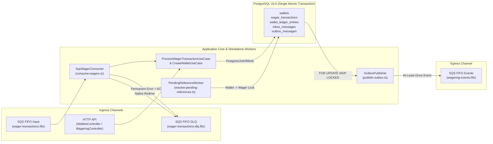
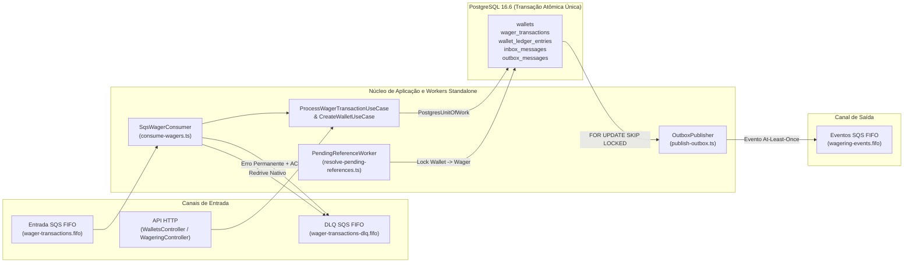

# Architecture and Implementation Decisions — Distributed Wagering Processor

**Language / Idioma:** [English](#english) | [Português](#português)

---

<a id="english"></a>

## English

### Normative References and Delivery Status

- **Normative Challenge Specification:** [`technical-challenge.md`](technical-challenge.md)
- **Reviewed Baseline Architecture:** [`Jungle-Architecture-v0.2.md`](Jungle-Architecture-v0.2.md)
- **Consolidated Delivery Evidence (`FIX-D01` + `FIX-D02`):** [`FIX-D01-D02-FINAL-EVIDENCE.md`](FIX-D01-D02-FINAL-EVIDENCE.md)
- **PostgreSQL Monetary Finiteness Evidence (`FIX-D01`):** [`FIX-D01-EVIDENCE.md`](FIX-D01-EVIDENCE.md)
- **IMP-04 Delivery Evidence:** [`FINAL-DELIVERY-EVIDENCE.md`](FINAL-DELIVERY-EVIDENCE.md)
- **Historical Package Evidence:** [`IMP-01-EVIDENCE.md`](IMP-01-EVIDENCE.md), [`IMP-02-EVIDENCE.md`](IMP-02-EVIDENCE.md), [`IMP-03-EVIDENCE.md`](IMP-03-EVIDENCE.md)

**Current Verified Baseline:** All implementation packages (`IMP-01` through `IMP-04`) and post-audit hardening packages (`FIX-D01` and `FIX-D02`) are complete and verified with **1,243 passing tests** (`991` unit tests across `27` files + `252` integration tests across `15` files), **0 failures**, and **8,253 assertions**, plus `bun run typecheck` (`tsc --noEmit`).

---

### Table of Contents

1. [Architecture Overview](#1-architecture-overview)
2. [Layer Organization](#2-layer-organization)
3. [Domain Modeling](#3-domain-modeling)
4. [Money and Decimal Precision](#4-money-and-decimal-precision)
5. [Wallet Aggregate](#5-wallet-aggregate)
6. [WagerTransaction Aggregate](#6-wagertransaction-aggregate)
7. [Immutable Ledger (`WalletLedgerEntry`)](#7-immutable-ledger-walletledgerentry)
8. [Transactional Inbox (`InboxMessage`)](#8-transactional-inbox-inboxmessage)
9. [Transactional Outbox (`OutboxMessage` & `IntegrationEvent`)](#9-transactional-outbox-outboxmessage--integrationevent)
10. [Unit of Work (`FinancialUnitOfWork` & `PostgresUnitOfWork`)](#10-unit-of-work-financialunitofwork--postgresunitofwork)
11. [PostgreSQL Transactions and Isolation](#11-postgresql-transactions-and-isolation)
12. [Pessimistic Locking and Lock Ordering](#12-pessimistic-locking-and-lock-ordering)
13. [Persistent Idempotency and Canonical Hashing](#13-persistent-idempotency-and-canonical-hashing)
14. [Distributed Concurrency](#14-distributed-concurrency)
15. [Reversals and Out-of-Order References](#15-reversals-and-out-of-order-references)
16. [PendingReferenceWorker and Terminal Overflow Handling (`FIX-D02`)](#16-pendingreferenceworker-and-terminal-overflow-handling-fix-d02)
17. [SQS Consumer](#17-sqs-consumer)
18. [OutboxPublisher](#18-outboxpublisher)
19. [Retry, Backoff, and Dead-Letter Queue (DLQ)](#19-retry-backoff-and-dead-letter-queue-dlq)
20. [Crash Recovery and Coordinated Shutdown](#20-crash-recovery-and-coordinated-shutdown)
21. [Versioned Migrations, Constraints, and `NaN` Protection (`FIX-D01`)](#21-versioned-migrations-constraints-and-nan-protection-fix-d01)
22. [Health Checks and Observability](#22-health-checks-and-observability)
23. [Authentication and IdP Extension Point](#23-authentication-and-idp-extension-point)
24. [Guarantee Responsibility Matrix and Trade-offs](#24-guarantee-responsibility-matrix-and-trade-offs)
25. [Known Limitations and Historical Package Traceability](#25-known-limitations-and-historical-package-traceability)

---

### 1. Architecture Overview

The Distributed Wagering Processor follows a modular Domain-Driven Design (DDD) and Ports-and-Adapters architecture built on **Bun 1.4.4**, **TypeScript 5.9.3 (strict)**, **NestJS 11.1.6**, **MikroORM 6.6.8**, **PostgreSQL 16.6**, and **AWS SQS (LocalStack 4.10.0)**.

Both synchronous HTTP requests (`POST /wagering/transactions`) and asynchronous SQS messages (`wager-transactions.fifo`) converge into the same application use case: [`ProcessWagerTransactionUseCase`](src/modules/wagering/application/process-wager-transaction.use-case.ts). PostgreSQL is the authoritative coordinator for concurrency, idempotency, balance non-negativity, ledger immutability, and atomic Inbox/Outbox persistence. SQS FIFO ordering (`MessageGroupId`) is treated purely as a throughput optimization, never as a substitute for database locks or constraints.



---

### 2. Layer Organization

The codebase is partitioned into three strict concentric layers across bounded modules (`shared`, `wallets`, `wagering`, `messaging`, and `database`):

1. **Domain Layer (`src/**/domain/*`):**
   - Contains pure business aggregates, value objects, domain events, and pure evaluation functions (`Money`, `Wallet`, `WalletLedgerEntry`, `WagerTransaction`, `evaluateWager`, `InboxMessage`, `OutboxMessage`, `IntegrationEvent`).
   - Free of framework decorators, ORM metadata, SQL queries, or AWS SDK imports.
2. **Application Layer (`src/**/application/*`):**
   - Defines transactional use cases (`CreateWalletUseCase`, `ProcessWagerTransactionUseCase`, `GetWalletUseCase`, `ListWalletLedgerUseCase`, `ReconcileWalletUseCase`, `GetWagerTransactionUseCase`) and worker coordinators (`SqsWagerConsumer`, `OutboxPublisher`, `PendingReferenceWorker`).
   - Depends only on domain objects and application ports (`FinancialUnitOfWork`, `FinancialStore`, `ClockPort`, `OperationalMetricsPort`, `OperationalLogPort`).
3. **Infrastructure Layer (`src/database/*`, `src/**/infrastructure/*`, `scripts/*`):**
   - Implements persistence (`PostgresUnitOfWork`, MikroORM `EntitySchema` definitions, `ExactNumericType`, versioned migrations), SQS transport (`AwsSqsConsumerTransport`, `AwsSqsOutboxTransport`, `localSqsClient`), health probes (`PostgresHealthProbe`, `HealthReadiness`), HTTP controllers, exception filters, and standalone CLI worker entrypoints.

---

### 3. Domain Modeling

All domain classes enforce state encapsulation and transition safety:

- **Private Constructors & Static Factories:** Every domain class uses a `private` (or `protected` on abstract `IntegrationEvent`) constructor and ECMAScript private fields (`#`). Object creation occurs through explicit factories (`Money.from`, `Wallet.open`, `WagerTransaction.create`, `WagerTransaction.createOpening`, `WalletLedgerEntry.create`, `InboxMessage.receive`, `OutboxMessage.enqueue`) that validate all invariants upfront.
- **Rehydration Factories (`rehydrate`):** Persistence adapters reconstruct domain instances using `static rehydrate(state)`. Rehydration copies dates and freezes structures without re-executing business transitions, incrementing versions, or emitting new events.
- **Defensive Copying & Immutability:** Domain instances are frozen via `Object.freeze`. All `Date` properties are cloned on input and in every getter. Event JSON payloads are deeply cloned and recursively frozen.
- **Identifier Policy (`ARC2-02`):** Internal entity IDs (`walletId`, `transactionId`, `ledgerEntryId`, `eventId`) are lowercase UUIDs generated via `node:crypto.randomUUID()`. External identifiers (`playerId`, `providerId`, `externalTransactionId`, `referenceExternalTransactionId`, `idempotencyKey`, `roundId`, `gameId`, `messageId`) are validated non-empty trimmed `TEXT` strings (`wallets.player_id` and `wager_transactions.player_id` use `TEXT` in PostgreSQL).

---

### 4. Money and Decimal Precision

[`Money`](src/shared/domain/money.ts) encapsulates exact decimal monetary amounts using a dedicated `Decimal.clone({ precision: 40 })` constructor from `decimal.js` `10.6.0`:

- **Zero Floating-Point Representation:** Monetary amounts are never converted to JavaScript `number` in domain, application, or persistence code. [`ExactNumericType`](src/database/exact-numeric-type.ts) rejects JS `number` values at the MikroORM driver boundary and maps PostgreSQL `NUMERIC(18,2)` columns strictly as decimal strings.
- **Strict Format & Range Validation:** External inputs must match `/^(?:0|[1-9]\d{0,15})\.\d{2}$/` (exact scale of 2 decimal places, up to 16 integer digits, no sign prefix, no leading zeroes, no whitespace, no scientific notation, no `NaN` or `Infinity`).
- **Maximum Supported Value:** `9999999999999999.99` (`NUMERIC(18,2)` ceiling). Any addition or subtraction exceeding this bound throws [`MoneyOverflowError`](src/shared/domain/domain-errors.ts).
- **Currency Safety:** Currency codes are validated against ISO-4217 codes supported by `Intl.supportedValuesOf('currency')` in the pinned Bun runtime (`BRL` is the primary currency; `USD` and cross-currency rejection are exercised across unit and integration suites). Binary operations (`add`, `subtract`, `isLessThan`, `equals`) throw [`CurrencyMismatchError`](src/shared/domain/domain-errors.ts) when currencies differ.

---

### 5. Wallet Aggregate

[`Wallet`](src/modules/wallets/domain/wallet.ts) is the aggregate root and concurrency boundary for a `(playerId, currency)` pair:

- **Opening (`Wallet.open` & `createWalletOpening`):** Initializes `version = 1`. If `initialBalance` is positive, [`createWalletOpening`](src/modules/wagering/domain/wallet-opening.ts) atomically builds the `Wallet`, an internal `OPENING` `WagerTransaction` (already `PROCESSED`, with `providerId = "SYSTEM"`, `externalTransactionId = "opening:<walletId>"`, `idempotencyKey = "SYSTEM:opening:<walletId>"`, `gameId = "SYSTEM_OPENING"`), a `CREDIT` `WalletLedgerEntry`, and two Outbox events (`WagerTransactionProcessed` and `WalletBalanceChanged`). If `initialBalance` is `0.00`, only the `Wallet` row is created.
- **Balance Movements (`debit` and `credit`):** Both methods validate currency match and positive movement amount, compute the new balance and the `WalletLedgerEntry` **before** mutating private state (`#balance`, `#version`, `#updatedAt`), and increment `version` by `1`. If a debit exceeds `#balance`, `debit` throws with the caller-supplied `FailureCode` (`INSUFFICIENT_FUNDS_BET` or `INSUFFICIENT_FUNDS_REVERSAL`); if a credit exceeds `NUMERIC(18,2)`, `Money.add` throws `MoneyOverflowError` before any field on `Wallet` is modified.

---

### 6. WagerTransaction Aggregate

[`WagerTransaction`](src/modules/wagering/domain/wager-transaction.ts) models the lifecycle and audit snapshot of every wagering operation:

```text
PENDING           -> PROCESSED | PENDING_REFERENCE | REJECTED | FAILED
PENDING_REFERENCE -> PROCESSED | REJECTED | FAILED
PROCESSED / REJECTED / FAILED -> Terminal (no further transitions allowed)
```

- **External vs Internal Creation:** `WagerTransaction.create` rejects `kind === "OPENING"` and `providerId === "SYSTEM"`. `BET` and `LOSS` reject `referenceExternalTransactionId`; `REFUND` and `ROLLBACK` require `referenceExternalTransactionId`; `WIN` accepts an optional `referenceExternalTransactionId`. Self-reference (`referenceExternalTransactionId === externalTransactionId`) is rejected.
- **Historical Balance Snapshot (`recordedBalance`):** `markProcessed`, `reject`, `markPendingReference`, and `fail` record the wallet balance observed at evaluation time (`recorded_balance_amount` and `recorded_balance_currency`). On `CURRENCY_MISMATCH` rejection, `money` preserves the submitted transaction currency while `recordedBalance` preserves the actual wallet currency. Terminal snapshots are immutable.
- **Failure Taxonomy (`FailureCode`):**

| `FailureCode` | Terminal Status | Meaning |
|---|---|---|
| `INSUFFICIENT_FUNDS_BET` | `REJECTED` | `BET` amount exceeds current wallet balance |
| `INSUFFICIENT_FUNDS_REVERSAL` | `REJECTED` | `ROLLBACK` debit (reverting `WIN` or `REFUND`) exceeds current wallet balance |
| `CURRENCY_MISMATCH` | `REJECTED` | Operation currency does not match wallet currency |
| `REFERENCE_NOT_FOUND_TIMEOUT` | `REJECTED` | Referenced transaction remained unavailable past `maxAttempts` or `TTL` |
| `REFERENCE_INVALID_KIND` | `REJECTED` | Referenced transaction `kind` is incompatible with `WIN`, `REFUND`, or `ROLLBACK` |
| `REFERENCE_CONTEXT_MISMATCH` | `REJECTED` | Referenced transaction belongs to a different player, wallet, round, or currency |
| `REFERENCE_AMOUNT_MISMATCH` | `REJECTED` | `REFUND` or `ROLLBACK` amount differs from the referenced transaction amount |
| `REFERENCE_NOT_PROCESSED` | `REJECTED` | Referenced transaction is in a non-`PROCESSED` terminal state (`REJECTED` or `FAILED`) |
| `REFERENCE_ALREADY_REVERSED` | `REJECTED` | Referenced transaction already has a processed `REFUND`/`ROLLBACK` reversal |
| `INFRASTRUCTURE_PERMANENT` | `FAILED` | Permanent infrastructure/representation failure (such as `NUMERIC(18,2)` overflow during `PENDING_REFERENCE` resolution) |

---

### 7. Immutable Ledger (`WalletLedgerEntry`)

[`WalletLedgerEntry`](src/modules/wallets/domain/wallet-ledger-entry.ts) is an append-only financial record with no mutable fields and no state transition methods:

- `WalletLedgerEntry.create` verifies that `money.isPositive()`, that `money`, `balanceBefore`, and `balanceAfter` share the same currency, and that `isBalanced()` holds (`balanceBefore + money == balanceAfter` for `CREDIT`; `balanceBefore - money == balanceAfter` for `DEBIT`).
- Every financial wager (`BET`, `WIN`, `REFUND`, `ROLLBACK`, `OPENING`) that reaches `PROCESSED` produces exactly one `WalletLedgerEntry` (`uq_ledger_transaction`).
- Non-movement operations (`LOSS`) and non-`PROCESSED` wagers (`PENDING_REFERENCE`, `REJECTED`, `FAILED`) never produce ledger entries.

---

### 8. Transactional Inbox (`InboxMessage`)

[`InboxMessage`](src/modules/messaging/domain/inbox-message.ts) provides persistent deduplication for SQS deliveries keyed by `(consumer_name, message_id)`:

- Claimed inside the same PostgreSQL transaction as the financial operation via `INSERT INTO inbox_messages ... ON CONFLICT (consumer_name, message_id) DO NOTHING RETURNING *`.
- Stores `payload_hash` (the canonical SHA-256 hash of the business wager payload) and `processed_at`.
- If a duplicate `(consumer_name, message_id)` arrives with a different `payload_hash`, `assertSamePayload` throws `IdempotencyConflictError`.
- If a redelivery arrives with a new `message_id` for an already-committed `idempotency_key`, the new `InboxMessage` row is marked `processed_at` and committed in the same transaction while returning the idempotent replay of the winning wager without duplicating financial movements or Outbox events.

---

### 9. Transactional Outbox (`OutboxMessage` & `IntegrationEvent`)

[`IntegrationEvent`](src/shared/domain/events/integration-event.ts) and [`OutboxMessage`](src/modules/messaging/domain/outbox-message.ts) guarantee that integration events are never published before database commit and are never lost if a process crashes after commit:

- **Concrete Event Subclasses (`version = 1`, `aggregateId = walletId`):**
  1. [`WagerTransactionProcessed`](src/modules/wagering/domain/events/wager-transaction-processed.ts) — emitted when any wager (including `LOSS` and positive `OPENING`) transitions to `PROCESSED`.
  2. [`WagerTransactionRejected`](src/modules/wagering/domain/events/wager-transaction-rejected.ts) — emitted when a wager transitions to `REJECTED`.
  3. [`WalletBalanceChanged`](src/modules/wallets/domain/events/wallet-balance-changed.ts) — emitted **only** when the wallet balance changes (`BET`, `WIN`, `REFUND`, `ROLLBACK`, positive `OPENING`).
  4. [`WagerTransactionPendingReference`](src/modules/wagering/domain/events/wager-transaction-pending-reference.ts) — emitted once when a wager is initially accepted as `PENDING_REFERENCE`.
- `OutboxMessage` uses `eventId` as its primary key (`id`), persists the serialized JSON envelope (`MoneyProps` strings, never `Money` instances), starts with `attempts = 0` and `nextAttemptAt = occurredAt`, and computes deterministic exponential backoff on retry: `min(maxDelayMs, baseDelayMs * 2^(attempts - 1))` (defaults: `baseDelayMs = 1000` ms, `maxDelayMs = 60000` ms). Outbox messages are never discarded due to attempt exhaustion.

---

### 10. Unit of Work (`FinancialUnitOfWork` & `PostgresUnitOfWork`)

[`FinancialUnitOfWork`](src/shared/application/financial-store.ts) and its PostgreSQL implementation [`PostgresUnitOfWork`](src/database/postgres-unit-of-work.ts) isolate each transaction attempt:

- Every call to `uow.run(work, options)` creates a clean MikroORM `EntityManager` fork (`orm.em.fork({ clear: true })`) and executes inside `em.transactional(..., { isolationLevel })`.
- [`PostgresFinancialStore`](src/database/postgres-financial-store.ts) executes explicit parameterized SQL statements against the transactional `SqlEntityManager` rather than relying on implicit ORM identity-map flush ordering. This makes lock acquisition order, constraint violation classification, and row-count assertions (`updateWallet`, `updatePendingWager`, `completeOutbox`, `failOutbox`) completely deterministic.

---

### 11. PostgreSQL Transactions and Isolation

- **Write Operations (`CreateWalletUseCase`, `ProcessWagerTransactionUseCase`, `PendingReferenceWorker`, `OutboxPublisher`):** Execute under PostgreSQL `READ COMMITTED` isolation combined with explicit pessimistic `FOR UPDATE` locks. Because `Wallet` is locked first via `SELECT ... FROM wallets WHERE id = ? FOR UPDATE`, PostgreSQL re-reads the latest committed row version upon acquiring the lock, preventing lost updates and write skew on the wallet balance.
- **Reconciliation (`ReconcileWalletUseCase`):** Executes under `REPEATABLE READ` isolation (`IsolationLevel.REPEATABLE_READ`) so that reading `wallets.balance` and aggregating `SUM(wallet_ledger_entries)` observe a single consistent MVCC snapshot without blocking concurrent writers.
- **Transient Fault Retries (`execution.ts`):** Deadlocks (`40P01`), serialization failures (`40001`), lock timeouts (`55P03`), statement timeouts (`57014`), and transient connection errors abort the current transaction completely, wait outside any transaction (`retryDelay`), and retry in a fresh `EntityManager` fork up to `maxAttempts` (`3` by default).

---

### 12. Pessimistic Locking and Lock Ordering

To prevent deadlocks across concurrent HTTP workers, SQS consumers, and `PendingReferenceWorker` instances, every financial write transaction enforces a strict lock hierarchy (`ARC2-01`):

1. **Pre-Lock Identity Read (Lock-Free):** `findIdentity(idempotencyKey, providerId, externalTransactionId)` checks if the key or external transaction ID is already committed. This ensures an already-used key with a mismatched payload or non-existent target wallet immediately raises `IdempotencyConflictError`.
2. **Lock 1 — `Wallet FOR UPDATE`:** `SELECT ... FROM wallets WHERE id = ? FOR UPDATE` is always the **first** row lock acquired in any financial transaction.
3. **Lock 2 — `Inbox Claim` (SQS channel only):** `INSERT INTO inbox_messages ... ON CONFLICT DO NOTHING RETURNING *` runs immediately after locking the wallet and before locking or inserting wagers.
4. **Lock 3 — `Wager / Same-Wallet Reference FOR UPDATE`:**
   - In `ProcessWagerTransactionUseCase`: if a referenced wager exists and belongs to the **same** wallet (`reference.walletId === wallet.id`), it is locked via `SELECT ... FROM wager_transactions WHERE id = ? FOR UPDATE`.
   - In `PendingReferenceWorker`: after locking `Wallet FOR UPDATE` and verifying ownership, the candidate wager is locked (`getWager(id, true)`), followed by the referenced wager (`getWager(ref.id, true)`) **only if** `ref.walletId === wallet.id`.
5. **Zero Cross-Wallet Locks:** An operation never locks a second wallet or a wager belonging to another wallet. If a reference belongs to another wallet, `evaluateWager` rejects it as `REFERENCE_CONTEXT_MISMATCH` using the lock-free read.

---

### 13. Persistent Idempotency and Canonical Hashing

- **Canonical Payload Hash (`wager-payload.ts`):** [`canonicalWagerPayload`](src/modules/wagering/application/wager-payload.ts) normalizes `money` via `Money.from(input.money).toJSON()`, normalizes missing `referenceExternalTransactionId` to `null`, sorts all JSON object keys lexicographically at every nesting level, and computes a lowercase hex `SHA-256` digest (`wagerPayloadHash`). Transport metadata (`Idempotency-Key` header name, `correlationId`, SQS `messageId`, `occurredAt`, `ReceiptHandle`) is excluded from the hash.
- **Dual Uniqueness Authorities:** PostgreSQL enforces `uq_wager_idempotency` (`UNIQUE (idempotency_key)`) and `uq_wager_provider_external` (`UNIQUE (provider_id, external_transaction_id)`).
- **Replay vs Conflict:**
  - If an incoming request matches an existing committed wager on **all** of `idempotencyKey`, `providerId`, `externalTransactionId`, and `payloadHash`, `assertReplay` succeeds and the use case returns the persisted `recordedBalance`, `status`, and `failureCode` with `idempotentReplay: true`.
  - If `idempotencyKey` and `(providerId, externalTransactionId)` match two different rows, or if any of `providerId`, `externalTransactionId`, `idempotencyKey`, or `payloadHash` diverges from the committed winner, `IdempotencyConflictError` (`409 Conflict`) is thrown without mutating any wallet.

---

### 14. Distributed Concurrency

The system operates safely across 3 or more concurrent processes:

- **Hot-Wallet Serialization:** Concurrent bets or reversals targeting the same `walletId` serialize on `SELECT ... FROM wallets WHERE id = ? FOR UPDATE`. In the mandatory challenge scenario (initial balance `100.00 BRL`, two simultaneous `80.00 BRL` bets), the first holder debits to `20.00 BRL` (`version = 2`, `PROCESSED`) and commits; the second holder acquires the lock, observes `20.00 BRL`, records a `REJECTED` wager (`INSUFFICIENT_FUNDS_BET`, `recordedBalance = 20.00 BRL`), and commits without altering wallet balance or ledger.
- **Cross-Wallet Parallelism:** Operations on distinct `walletId`s lock disjoint rows in `wallets` and execute in parallel without contention.
- **Cross-Wallet Key Collision Race:** If two concurrent requests reuse the same `idempotency_key` targeting two **different** wallets (`walletA` and `walletB`), both may lock their respective wallets simultaneously, and the second `INSERT INTO wager_transactions` fails with `SQLSTATE 23505` (`uq_wager_idempotency`). `ProcessWagerTransactionUseCase` catches `23505` on business unique constraints, allows the losing transaction to roll back completely (leaving the losing wallet untouched), re-reads the committed winner in a fresh read-only transaction, and raises `IdempotencyConflictError` (or returns replay if identical).

---

### 15. Reversals and Out-of-Order References

[`evaluateWager`](src/modules/wagering/domain/wager-rules.ts) is a pure decision function that evaluates reference and balance rules under the wallet lock:

- **Reference Matching:** Resolved by `(providerId, referenceExternalTransactionId)`. Must match `playerId`, `walletId`, `roundId`, and `currency` (`REFERENCE_CONTEXT_MISMATCH` otherwise).
- **Allowed Reference Kinds:**
  - `WIN` (when `referenceExternalTransactionId` is provided) must reference a `BET`.
  - `REFUND` must reference a `BET` (`REFERENCE_INVALID_KIND` otherwise).
  - `ROLLBACK` must reference a `BET`, `WIN`, or `REFUND` (`REFERENCE_INVALID_KIND` otherwise).
- **Exact Amount for Reversals:** `REFUND` and `ROLLBACK` must have `money.equals(reference.money)` (`REFERENCE_AMOUNT_MISMATCH` otherwise). `WIN` may have any positive amount.
- **Single Reversal Invariant:** A referenced transaction can have at most **one** `PROCESSED` reversal (`REFUND` or `ROLLBACK`), enforced both in domain rules (`referenceAlreadyReversed`, including rejecting a late `WIN` referencing an already-reversed `BET`) and at the database level via partial unique index `uq_wager_processed_reversal`. Chained reversals (`BET -> REFUND -> ROLLBACK(ref=REFUND)`) are valid because the `ROLLBACK` references the `REFUND` transaction, not the already-reversed `BET`.
- **Out-of-Order Arrival:** When `reference` does not yet exist in `wager_transactions` or is still non-terminal (`PENDING` / `PENDING_REFERENCE`), `evaluateWager` returns `{ status: 'PENDING_REFERENCE' }`. If `reference` is already terminal `REJECTED` or `FAILED`, `evaluateWager` immediately rejects the dependent wager with `REFERENCE_NOT_PROCESSED`.

---

### 16. PendingReferenceWorker and Terminal Overflow Handling (`FIX-D02`)

[`PendingReferenceWorker`](src/modules/wagering/application/pending-reference-worker.ts) and [`pending-reference-policy.ts`](src/modules/wagering/application/pending-reference-policy.ts) manage the lifecycle of `PENDING_REFERENCE` transactions:

- **Shared Policy (`pending-reference-policy.ts`):** Both initial acceptance in `ProcessWagerTransactionUseCase` and subsequent retries in `PendingReferenceWorker` share `PENDING_REF_BASE_DELAY_MS` (`1000` ms), `PENDING_REF_MAX_ATTEMPTS` (`10`), and `PENDING_REF_TTL_MS` (`86400000` ms / 24h).
- **Lock-Free Discovery & Per-Candidate Isolation:** `findDuePendingWagers(now, limit)` queries `status = 'PENDING_REFERENCE' AND next_retry_at <= ?` ordered by `(next_retry_at ASC, created_at ASC, id ASC)` without holding row locks. Each candidate is processed in its own isolated UoW (`Wallet FOR UPDATE` -> ownership check -> `Wager FOR UPDATE` -> `now = runtime.now()` revalidation -> same-wallet `Reference FOR UPDATE`). A failure on one candidate never aborts or blocks subsequent candidates in the batch.
- **TTL Semantics (Approved Option A):** `expiresAt` limits how long a wager waits for an **unavailable** reference. If the referenced transaction is already available and valid when `PendingReferenceWorker` evaluates the candidate, the wager is processed normally even if the worker scan was delayed past `expiresAt`. If the reference is still missing/pending and either `attempts + 1 >= maxAttempts`, `now >= expiresAt`, or the next backoff timestamp `nextRetryAt >= expiresAt`, the wager transitions to `REJECTED` with `FailureCode.ReferenceNotFoundTimeout` (`REFERENCE_NOT_FOUND_TIMEOUT`) and enqueues `WagerTransactionRejected`.
- **Terminal Overflow Handling (`FIX-D02`):**
  - If a `WIN`, `REFUND`, or `ROLLBACK` was accepted as `PENDING_REFERENCE` and, by the time its reference arrives, the wallet balance has grown near `9999999999999999.99` (`NUMERIC(18,2)` max), executing `wallet.credit(...)` throws [`MoneyOverflowError`](src/shared/domain/domain-errors.ts) before mutating `wallet`.
  - Rather than letting `MoneyOverflowError` escape as an unhandled exception (which would leave `attempts` and `next_retry_at` unchanged in an infinite retry loop) or misclassifying it as `REFERENCE_NOT_FOUND_TIMEOUT`, `PendingReferenceWorker` catches `MoneyOverflowError` on the movement calculation and transitions the wager `PENDING_REFERENCE -> FAILED` with `FailureCode.InfrastructurePermanent` (`INFRASTRUCTURE_PERMANENT`) and `wallet.balance` as the recorded snapshot:
    - Calls `wager.fail(FailureCode.InfrastructurePermanent, wallet.balance)` (which clears `nextRetryAt` and `expiresAt`).
    - Persists `store.updatePendingWager(wager)` inside the same transaction under `Wallet -> Wager` locks (requiring `1` affected row or aborting with `PersistenceInvariantError`).
    - Does **not** modify `wallets.balance`, `wallets.version`, or `wallet_ledger_entries`, and does **not** enqueue `Processed`, `Rejected`, or `BalanceChanged` Outbox events.
    - Emits structured operational log (`event: "pending_reference_failed"`, `code: "MONEY_OVERFLOW"`, `failureCode: "INFRASTRUCTURE_PERMANENT"`) and `wager-status: "FAILED"` metric **after** database commit.
    - Subsequent worker scans ignore the terminal row, and HTTP/SQS replays return the persisted `FAILED` snapshot (`422 Unprocessable Entity` on HTTP, `ACK` on SQS).

---

### 17. SQS Consumer

[`SqsWagerConsumer`](src/modules/messaging/application/sqs-wager-consumer.ts) (entrypoint [`scripts/consume-wagers.ts`](scripts/consume-wagers.ts)) processes messages from `wager-transactions.fifo`:

- **Startup Verification:** Verifies that `wager-transactions.fifo` and `wager-transactions-dlq.fifo` exist, are FIFO queues with `ContentBasedDeduplication = "false"`, and that `wager-transactions.fifo` has a `RedrivePolicy` targeting the DLQ ARN with `maxReceiveCount === SQS_MAX_RECEIVE_COUNT` (`5`).
- **Post-Commit ACK Guarantee:** `DeleteMessage` is invoked **only** after `ProcessWagerTransactionUseCase.execute` commits (`PROCESSED`, `REJECTED`, `PENDING_REFERENCE`, or idempotent replay including historical `FAILED`). If `DeleteMessage` fails after commit, the consumer logs `ACK_FAILED` and returns `'ack-failed'`; the subsequent SQS redelivery hits the committed `InboxMessage` / `WagerTransaction` and ACKs cleanly as an idempotent replay.
- **Error Classification (`REV3-FIX-01`):**
  - **Permanent Contract/Identity Errors** (`InvalidJsonEnvelope`, `InvalidDomainInputError`, `InvalidMoneyError`, `MoneyOverflowError`, `CurrencyMismatchError`, `IdempotencyConflictError`): Forwarded manually to `wager-transactions-dlq.fifo` as a sanitized `WagerTransactionDeadLetter` JSON diagnostic (containing `messageId`, `sqsMessageId`, `payloadHash`, `errorCode`, `receiveCount`, and `failedAt`, omitting raw financial payloads and secrets). The source message is deleted **only after** `SendMessage` to the DLQ succeeds.
  - **Transient & Unknown Errors** (`NotFoundError`, PostgreSQL `40P01`/`40001`/`55P03`/`57014`/`08*`/`57P*`/`53300`, network timeouts, and unclassified errors): Never trigger manual DLQ transfers or source deletion. The consumer adjusts visibility timeout via exponential backoff (`ChangeMessageVisibility`) and lets SQS native `RedrivePolicy` move the original `WagerTransactionRequested` envelope to the DLQ after `maxReceiveCount` receives.

---

### 18. OutboxPublisher

[`OutboxPublisher`](src/modules/messaging/application/outbox-publisher.ts) (entrypoint [`scripts/publish-outbox.ts`](scripts/publish-outbox.ts)) delivers committed integration events from `outbox_messages` to `wagering-events.fifo`:

1. **Lease Claim (`claimOutbox`):** In a short transaction, selects one due row (`published_at IS NULL AND next_attempt_at <= ? AND (claimed_until IS NULL OR claimed_until <= ?)`) ordered by `(next_attempt_at ASC, occurred_at ASC, id ASC)` using `FOR UPDATE SKIP LOCKED`, stamps `claim_owner`, a fresh UUID `claim_token`, and `claimed_until = now + leaseMs` (`10000` ms default), and commits.
2. **Pre-Send Lease Margin Check:** Before calling SQS outside the SQL transaction, verifies that `claimed_until - now >= sendTimeoutMs + 1000` (`3000` ms + `1000` ms margin).
3. **SQS Publication:** Publishes the immutable JSON payload to `wagering-events.fifo` with `MessageGroupId = aggregateId` (`walletId`) and `MessageDeduplicationId = eventId`, bounded by `AbortSignal.timeout(sendTimeoutMs)`.
4. **Lease-Fenced Confirmation (`completeOutbox` / `failOutbox`):** Opens a second transaction executing `UPDATE outbox_messages SET published_at = ?, claim_owner = NULL, claim_token = NULL, claimed_until = NULL WHERE id = ? AND published_at IS NULL AND claim_owner = ? AND claim_token = ? AND claimed_until > ?`. If a slow publisher's lease expired and another publisher already claimed the row, the fenced `UPDATE` affects `0` rows (`false`) and prevents stale-owner corruption.

---

### 19. Retry, Backoff, and Dead-Letter Queue (DLQ)

| Subsystem | Retry Trigger | Backoff Strategy | Exhaustion Behavior |
|---|---|---|---|
| **PostgreSQL UoW** (`ProcessWager`, `CreateWallet`, `PendingRef`) | `40P01`, `40001`, `55P03`, `57014`, `23505` (business unique race) | `20ms * 2^attempt` outside transaction (`maxAttempts = 3`) | Throws `RetryExhaustedError` (`503` on HTTP; transient visibility retry on SQS) |
| **SQS Consumer** (`SqsWagerConsumer`) | Transient DB/network error, missing wallet (`NotFoundError`), or unknown error | `ChangeMessageVisibility` backoff (`min(visibilityTimeout, 2^(receiveCount - 1))`) | Native SQS `RedrivePolicy` transfers original message to `wager-transactions-dlq.fifo` after `5` receives |
| **SQS Consumer Permanent Errors** | Malformed JSON, invalid DTO/Money, `IdempotencyConflictError` | Immediate (`0` retries) | Sends sanitized `WagerTransactionDeadLetter` to DLQ, then `DeleteMessage` on input queue |
| **Outbox Publisher** (`OutboxPublisher`) | SQS `SendMessage` error or timeout | `min(60000ms, 1000ms * 2^(attempts - 1))` via `failOutbox` | Retries indefinitely until published (events are never dropped) |
| **Pending Reference** (`PendingReferenceWorker`) | Referenced transaction missing or still non-terminal | `1000ms * 2^attempts` (`maxAttempts = 10`, `TTL = 86400000ms`) | Transitions wager to `REJECTED` (`REFERENCE_NOT_FOUND_TIMEOUT`) and enqueues `WagerTransactionRejected` |

---

### 20. Crash Recovery and Coordinated Shutdown

- **Coordinated Worker Shutdown (`worker-shutdown.ts`, `worker-signals.ts`):**
  - Standalone workers (`consume-wagers.ts`, `publish-outbox.ts`, `resolve-pending-references.ts`) register `SIGTERM`/`SIGINT` handlers via [`enableWorkerSignals`](src/shared/application/worker-signals.ts) (programmatic callers use `closeWorkerApplication`).
  - On signal receipt, `WorkerShutdown` arms a hard watchdog timer (`WORKER_SHUTDOWN_TIMEOUT_MS`, default `60000` ms), aborts idle polling via `AbortSignal`, waits for the current in-flight operation to finish while the PostgreSQL connection pool is still open (allowing post-commit SQS ACK or Outbox confirmation to complete), then invokes `app.close(signal)` to close MikroORM and destroy SQS clients before disarming the watchdog.
  - If an idle SQS long-poll returns a message after shutdown has started, the consumer immediately releases visibility (`ChangeMessageVisibility(0)`) without processing or ACKing it.
  - If the shutdown deadline expires while an operation or resource disposal is stuck, the watchdog terminates the process with `process.exit(1)` so the supervisor can restart it cleanly.
- **Crash Consistency at Every Failure Boundary (`SIGKILL` / Power Loss):**
  - **Before SQL Commit:** PostgreSQL automatically rolls back uncommitted changes across all 5 tables.
  - **After SQL Commit, Before HTTP Response or SQS ACK:** On retry/redelivery, `idempotency_key` and `inbox_messages` return the committed historical snapshot (`idempotentReplay: true`) and complete the SQS ACK without duplicating debits, credits, or Outbox events.
  - **After Outbox Claim or After SQS `SendMessage`, Before `completeOutbox`:** When `claimed_until` expires (`10000` ms), another publisher claims and republishes the event (`at-least-once` delivery with stable `eventId` and SQS FIFO deduplication within the 5-minute deduplication window).

---

### 21. Versioned Migrations, Constraints, and `NaN` Protection (`FIX-D01`)

Schema management is governed strictly by versioned, transactional, reversible migrations registered in [`src/database/config.ts`](src/database/config.ts) (`transactional: true, allOrNothing: true, snapshot: false`):

1. **[`Migration202611040001.ts`](src/database/migrations/Migration202611040001.ts) (Baseline Financial Schema — SHA-256 `597fb090...`):**
   - Creates `wallets`, `wager_transactions`, `wallet_ledger_entries`, `inbox_messages`, and `outbox_messages`.
   - Enforces unique constraints (`uq_wallets_player_currency`, `uq_wager_idempotency`, `uq_wager_provider_external`, `uq_ledger_transaction`, `uq_wager_processed_reversal` partial unique index, `pk_inbox_messages`).
   - Enforces non-negativity and state invariants (`ck_wallet_balance_non_negative`, `ck_wallet_version_positive`, `ck_wager_amount_positive`, `ck_wager_recorded_balance_non_negative`, `ck_wager_status_fields`, `ck_ledger_amount_positive`, `ck_ledger_balances_non_negative`, `ck_ledger_balance_math`, `ck_outbox_claim_all_or_none`).
   - Installs immediate triggers blocking `UPDATE`/`DELETE` on `wallet_ledger_entries`, blocking mutations/deletions of terminal `wager_transactions`, and validating reference context/kind/amount on processed wagers.
   - Installs `DEFERRABLE INITIALLY DEFERRED` constraint triggers (`trg_wallet_balance_matches_ledger`, `trg_wager_ledger_consistency`, `trg_ledger_requires_processed_wager`) verifying at `COMMIT` that every wallet's materialized `balance` equals the exact sum of its ledger entries and every `PROCESSED` balance-affecting wager has a matching ledger entry.
2. **[`Migration202611060001.ts`](src/database/migrations/Migration202611060001.ts) (`FIX-D01` Monetary Finiteness Hardening — SHA-256 `bcb5d7f0...`):**
   - **Root Cause Addressed:** PostgreSQL `NUMERIC(18,2)` natively rejects `Infinity`/`-Infinity` via typmod (`SQLSTATE 22003`), but permits `'NaN'::numeric`. Because `'NaN'::numeric >= 0` and `'NaN'::numeric = 'NaN'::numeric` evaluate to `TRUE` in PostgreSQL, a direct SQL write containing `'NaN'::numeric` across wallet, wager, and ledger could previously satisfy arithmetic checks and deferred triggers.
   - **Solution:** Adds three immediate `CHECK` constraints (without `NOT VALID`) covering all six monetary `NUMERIC(18,2)` columns:
     - `wallets`: `ck_wallet_all_finite CHECK (balance NOT IN ('NaN'::numeric, 'Infinity'::numeric, '-Infinity'::numeric))`
     - `wager_transactions`: `ck_wager_all_finite CHECK (amount NOT IN ('NaN'::numeric, 'Infinity'::numeric, '-Infinity'::numeric) AND recorded_balance_amount NOT IN ('NaN'::numeric, 'Infinity'::numeric, '-Infinity'::numeric))` (`NULL` on `recorded_balance_amount` continues to pass because `NULL NOT IN (...)` evaluates to `UNKNOWN`, which satisfies SQL `CHECK` constraints).
     - `wallet_ledger_entries`: `ck_ledger_all_finite CHECK (amount NOT IN ('NaN'::numeric, 'Infinity'::numeric, '-Infinity'::numeric) AND balance_before NOT IN ('NaN'::numeric, 'Infinity'::numeric, '-Infinity'::numeric) AND balance_after NOT IN ('NaN'::numeric, 'Infinity'::numeric, '-Infinity'::numeric))`
   - **Legacy Data Integrity & Atomicity:** Because the constraints are added without `NOT VALID` inside a transactional migration, PostgreSQL immediately validates all existing rows. Any legacy `NaN` in any of the three tables aborts the entire `UP` migration with `SQLSTATE 23514` (`check_violation`) without modifying historical data or leaving partial constraints.
   - **Surgical `DOWN`:** `Migration202611060001.down()` drops **only** `ck_ledger_all_finite`, `ck_wager_all_finite`, and `ck_wallet_all_finite`, preserving all tables, records, triggers, and baseline constraints from `Migration202611040001`.

---

### 22. Health Checks and Observability

- **Health Endpoints (`HealthController` & `HealthReadiness`):**
  - `GET /health/live`: Returns `200 OK` `{ "status": "ok" }`.
  - `GET /health/ready`: Coalesces concurrent readiness checks into a single bounded flight (`HEALTH_READINESS_TIMEOUT_MS`, default `1500` ms) executing `PostgresHealthProbe` (`SELECT 1`) and the `HealthReadiness` SQS probe (verifying `wager-transactions.fifo`, `wager-transactions-dlq.fifo`, `wagering-events.fifo`, FIFO attributes, and `RedrivePolicy`). Returns `200 OK` when both dependencies are `"up"`, or `503 Service Unavailable` (`"not_ready"` or `"draining"` once shutdown starts).
- **Operational Metrics (`MetricsController` & `DefaultOperationalMetricsCollector`):**
  - `DatabaseModule` provides a single `OPERATIONAL_METRICS` collector instance shared across the financial use cases and workers within that DI graph.
  - `GET /metrics` returns a deep-frozen `OperationalMetricsSnapshot` (`scope: "process"`). Counters saturate at `Number.MAX_SAFE_INTEGER`, label sets have fixed cardinality, and `operationalMetricsEmitter` isolates observer exceptions, rejected promises, and reentrancy so observability faults can never alter financial outcomes.
- **Structured Logging (`operational-logging.ts`):**
  - Emits sanitized single-line JSON logs to `stderr` (`stderrOperationalLog`), propagating `x-correlation-id` and redacting sensitive keys and credentials.

---

### 23. Authentication and IdP Extension Point

Following Section 2 of [`technical-challenge.md`](technical-challenge.md), external authentication was intentionally left unimplemented to dedicate the development window to financial correctness, concurrency, idempotency, and distributed recovery:

- **Explicit Extension Point in Code:** [`ProviderIdentityGuard`](src/shared/infrastructure/provider-identity.guard.ts) implements NestJS `CanActivate` and is attached via `@UseGuards(ProviderIdentityGuard)` on [`WalletsController`](src/modules/wallets/infrastructure/wallets.controller.ts) and [`WageringController`](src/modules/wagering/infrastructure/wagering.controller.ts), while [`HealthController`](src/shared/infrastructure/health.controller.ts) remains open.
- **Target Production IdP Design (Keycloak / Zitadel via OIDC):**
  1. Deploy an external OIDC-compliant Identity Provider (Keycloak or Zitadel) issuing short-lived asymmetric JWT access tokens (`RS256` / `ES256`) to game providers via OAuth 2.0 `client_credentials`.
  2. In `ProviderIdentityGuard`, validate the `Authorization: Bearer <token>` header against the IdP's cached JWKS endpoint, checking cryptographic signature, `iss` (issuer), `aud` (audience), `exp`/`nbf` timestamps, and required scopes.
  3. Extract the authenticated provider identity claim (`provider_id`) from the verified token and bind it to the request context, rejecting any `POST /wagering/transactions` or `GET /providers/:providerId/...` request where the payload/path `providerId` does not match the authenticated principal (`403 Forbidden`).
  4. Keep SQS on an internal private VPC/IAM boundary where messages remain subject to full domain validation.

---

### 24. Guarantee Responsibility Matrix and Trade-offs

| Financial / Distributed Property | Domain Layer (TypeScript) | PostgreSQL 16.6 (Schema / Locks / Triggers) | SQS / Worker Protocol |
|---|---|---|---|
| **Exact decimal scale & no `NaN`/`±Infinity`** | `Money.from` regex & `decimal.js` (`precision: 40`), `ExactNumericType` | `NUMERIC(18,2)` typmod + `ck_wallet_all_finite`, `ck_wager_all_finite`, `ck_ledger_all_finite` (`FIX-D01`) | JSON string serialization (`MoneyProps`) |
| **Non-negative wallet balance** | `Wallet.debit` balance check | `ck_wallet_balance_non_negative` (`balance >= 0`) | N/A |
| **Serialized per-wallet updates (no lost updates)** | Immutable `Money` + version increment | `SELECT ... FROM wallets WHERE id = ? FOR UPDATE` | FIFO `MessageGroupId = walletId` (optimization only) |
| **1-to-1 movement and immutable ledger** | `Wallet.debit`/`credit` returns `WalletLedgerEntry` | `uq_ledger_transaction`, append-only trigger, deferred `trg_wallet_balance_matches_ledger` & `trg_wager_ledger_consistency` | N/A |
| **Persistent idempotency & conflict detection** | `WagerTransaction.assertReplay`, `wagerPayloadHash` | `uq_wager_idempotency`, `uq_wager_provider_external`, `pk_inbox_messages` | Post-commit `DeleteMessage` (ACK) |
| **Single reversal per reference** | `evaluateWager` (`referenceAlreadyReversed`) | Partial unique index `uq_wager_processed_reversal` | `PendingReferenceWorker` under `Wallet -> Wager` lock |
| **Convergence on `PENDING_REFERENCE` overflow** | `MoneyOverflowError` before `Wallet` mutation | Atomic `updatePendingWager` (`FAILED` / `INFRASTRUCTURE_PERMANENT`) under `Wallet -> Wager` lock (`FIX-D02`) | Terminal replay (`422` on HTTP, `ACK` on SQS) |
| **No event published before commit / no lost events** | `OutboxMessage.enqueue` | Atomic commit of `outbox_messages` + `FOR UPDATE SKIP LOCKED` lease fencing | At-least-once publish to `wagering-events.fifo` |

#### Key Trade-offs

1. **Pessimistic `FOR UPDATE` Locking vs Optimistic Locking:** Pessimistic locking on `wallets` serializes hot-wallet bursts inside PostgreSQL without burning CPU and database round-trips on optimistic version-conflict aborts, while keeping unrelated wallets completely lock-free.
2. **Explicit Parameterized SQL in `PostgresFinancialStore` vs ORM Auto-Flush:** Writing explicit SQL inside `EntityManager.transactional()` guarantees exact lock acquisition order (`Wallet -> Inbox -> Wager`) and deterministic constraint error handling without sacrificing MikroORM migration and transaction management.
3. **At-Least-Once Outbox with Lease Fencing vs Distributed 2PC:** Lease-fenced `SKIP LOCKED` claims avoid blocking financial commits on broker availability and recover automatically when a publisher crashes mid-send, at the standard cost of requiring downstream consumers to deduplicate by `eventId`.

---

### 25. Known Limitations and Historical Package Traceability

#### Known Limitations

- **Unauthenticated Local API:** `ProviderIdentityGuard` is a no-op extension point as permitted by the challenge; OIDC integration is required for untrusted network exposure.
- **Process-Scoped Metrics:** `GET /metrics` exposes the in-memory collector of the HTTP process (`scope: "process"`) without cross-process aggregation.
- **DLQ Envelope Coexistence:** `wager-transactions-dlq.fifo` can hold both `WagerTransactionDeadLetter` (manual sanitized diagnostic for permanent errors) and `WagerTransactionRequested` (native SQS redrive after transient exhaustion). Operational tooling must inspect `type` before replaying.
- **Migration Validation Lock Cost:** `Migration202611060001` validates existing rows immediately (without `NOT VALID`); on large pre-existing tables, `ALTER TABLE ... ADD CONSTRAINT` acquires table locks and scans existing rows.
- **TypeScript `skipLibCheck`:** Enabled per Bun's recommendation to bypass internal declaration conflicts between `@types/bun` and `@types/node` while keeping `strict: true` across all project code.

#### Historical Package Traceability

| Package / Milestone | Summary of Delivered Scope | Evidence Document |
|---|---|---|
| **IMP-01** | Foundation, NestJS bootstrap, pure `Money`, `Wallet`, `WagerTransaction`, `WalletLedgerEntry`, `InboxMessage`, `OutboxMessage`, `IntegrationEvent`, and 93 domain unit tests | [`IMP-01-EVIDENCE.md`](IMP-01-EVIDENCE.md) |
| **IMP-02** | PostgreSQL 16.6 + MikroORM 6.6.8 persistence, `Migration202611040001`, `PostgresUnitOfWork`, `Wallet -> Inbox -> Wager` locking, financial use cases, reconciliation, and 3-process concurrency tests | [`IMP-02-EVIDENCE.md`](IMP-02-EVIDENCE.md) |
| **IMP-03 (`CP-01..05` & `REV3-FIX-01`)** | LocalStack SQS adapters, `SqsWagerConsumer`, `OutboxPublisher` with lease fencing, `PendingReferenceWorker` (TTL Option A), coordinated `SIGTERM` shutdown, and subprocess entrypoint tests | [`IMP-03-EVIDENCE.md`](IMP-03-EVIDENCE.md) |
| **IMP-04 (`CP-01..05B` & `FINAL-DELIVERY-01`)** | HTTP controllers (`WalletsController`, `WageringController`, `HealthController`, `MetricsController`), `HttpExceptionFilter`, sanitized structured logging, operational metrics (`G6A` + `G6B`), and `1,205` passing tests | [`FINAL-DELIVERY-EVIDENCE.md`](FINAL-DELIVERY-EVIDENCE.md) |
| **FIX-D01 & FIX-D02 (`FIX-D01-D02-FINAL`)** | `Migration202611060001` rejecting `NaN`/`±Infinity` across all 6 monetary columns, `PendingReferenceWorker` terminalizing `MoneyOverflowError` as `FAILED` (`INFRASTRUCTURE_PERMANENT`), `REV-D02-01/02` crash/multiprocess tests, and `1,243` passing tests | [`FIX-D01-EVIDENCE.md`](FIX-D01-EVIDENCE.md), [`FIX-D01-D02-FINAL-EVIDENCE.md`](FIX-D01-D02-FINAL-EVIDENCE.md) |

---

<a id="português"></a>

## Português

### Referências Normativas e Estado da Entrega

- **Especificação Normativa do Desafio:** [`technical-challenge.md`](technical-challenge.md)
- **Arquitetura Base Revisada:** [`Jungle-Architecture-v0.2.md`](Jungle-Architecture-v0.2.md)
- **Evidência Consolidada da Entrega (`FIX-D01` + `FIX-D02`):** [`FIX-D01-D02-FINAL-EVIDENCE.md`](FIX-D01-D02-FINAL-EVIDENCE.md)
- **Evidência de Finitude Monetária no PostgreSQL (`FIX-D01`):** [`FIX-D01-EVIDENCE.md`](FIX-D01-EVIDENCE.md)
- **Evidência de Entrega do IMP-04:** [`FINAL-DELIVERY-EVIDENCE.md`](FINAL-DELIVERY-EVIDENCE.md)
- **Evidências Históricas por Pacote:** [`IMP-01-EVIDENCE.md`](IMP-01-EVIDENCE.md), [`IMP-02-EVIDENCE.md`](IMP-02-EVIDENCE.md), [`IMP-03-EVIDENCE.md`](IMP-03-EVIDENCE.md)

**Baseline Atual Verificada:** Todos os pacotes de implementação (`IMP-01` a `IMP-04`) e os pacotes de endurecimento pós-auditoria (`FIX-D01` e `FIX-D02`) estão concluídos e verificados com **1.243 testes aprovados** (`991` unitários em `27` arquivos + `252` de integração em `15` arquivos), **0 falhas** e **8.253 asserções**, além de `bun run typecheck` (`tsc --noEmit`).

---

### Sumário

1. [Visão Geral da Arquitetura](#1-visão-geral-da-arquitetura)
2. [Organização das Camadas](#2-organização-das-camadas)
3. [Modelagem do Domínio](#3-modelagem-do-domínio)
4. [Money e Precisão Decimal](#4-money-e-precisão-decimal)
5. [Agregado Wallet](#5-agregado-wallet)
6. [Agregado WagerTransaction](#6-agregado-wagertransaction)
7. [Ledger Imutável (`WalletLedgerEntry`)](#7-ledger-imutável-walletledgerentry)
8. [Transactional Inbox (`InboxMessage`)](#8-transactional-inbox-inboxmessage)
9. [Transactional Outbox (`OutboxMessage` e `IntegrationEvent`)](#9-transactional-outbox-outboxmessage-e-integrationevent)
10. [Unit of Work (`FinancialUnitOfWork` e `PostgresUnitOfWork`)](#10-unit-of-work-financialunitofwork-e-postgresunitofwork)
11. [Transações PostgreSQL e Isolamento](#11-transações-postgresql-e-isolamento)
12. [Locks Pessimistas e Ordem de Aquisição](#12-locks-pessimistas-e-ordem-de-aquisição)
13. [Idempotência Persistente e Hash Canônico](#13-idempotência-persistente-e-hash-canônico)
14. [Concorrência Distribuída](#14-concorrência-distribuída)
15. [Reversões e Referências Fora de Ordem](#15-reversões-e-referências-fora-de-ordem)
16. [PendingReferenceWorker e Tratamento Terminal de Overflow (`FIX-D02`)](#16-pendingreferenceworker-e-tratamento-terminal-de-overflow-fix-d02)
17. [SQS Consumer](#17-sqs-consumer-1)
18. [OutboxPublisher](#18-outboxpublisher-1)
19. [Retry, Backoff e Dead-Letter Queue (DLQ)](#19-retry-backoff-e-dead-letter-queue-dlq)
20. [Recuperação após Falhas e Shutdown Coordenado](#20-recuperação-após-falhas-e-shutdown-coordenado)
21. [Migrations Versionadas, Constraints e Proteção contra `NaN` (`FIX-D01`)](#21-migrations-versionadas-constraints-e-proteção-contra-nan-fix-d01)
22. [Health Checks e Observabilidade](#22-health-checks-e-observabilidade)
23. [Autenticação e Ponto de Extensão IdP](#23-autenticação-e-ponto-de-extensão-idp)
24. [Matriz de Responsabilidade das Garantias e Trade-offs](#24-matriz-de-responsabilidade-das-garantias-e-trade-offs)
25. [Limitações Conhecidas e Rastreabilidade Histórica dos Pacotes](#25-limitações-conhecidas-e-rastreabilidade-histórica-dos-pacotes)

---

### 1. Visão Geral da Arquitetura

O Distributed Wagering Processor adota uma arquitetura modular orientada a Domain-Driven Design (DDD) e Ports-and-Adapters construída sobre **Bun 1.4.4**, **TypeScript 5.9.3 (strict)**, **NestJS 11.1.6**, **MikroORM 6.6.8**, **PostgreSQL 16.6** e **AWS SQS (LocalStack 4.10.0)**.

Tanto as requisições HTTP síncronas (`POST /wagering/transactions`) quanto as mensagens SQS assíncronas (`wager-transactions.fifo`) convergem para o mesmo caso de uso de aplicação: [`ProcessWagerTransactionUseCase`](src/modules/wagering/application/process-wager-transaction.use-case.ts). O PostgreSQL atua como autoridade central para concorrência, idempotência, não-negatividade de saldo, imutabilidade do ledger e persistência atômica de Inbox/Outbox. A ordenação de filas SQS FIFO (`MessageGroupId`) é tratada exclusivamente como otimização de vazão, nunca como substituto para locks ou constraints do banco de dados.



---

### 2. Organização das Camadas

O código está estruturado em três camadas concêntricas estritas distribuídas entre módulos delimitados (`shared`, `wallets`, `wagering`, `messaging` e `database`):

1. **Camada de Domínio (`src/**/domain/*`):**
   - Contém agregados de negócio puros, objetos de valor, eventos de domínio e funções puras de decisão (`Money`, `Wallet`, `WalletLedgerEntry`, `WagerTransaction`, `evaluateWager`, `InboxMessage`, `OutboxMessage`, `IntegrationEvent`).
   - Isenta de decorators de framework, metadados de ORM, consultas SQL ou importações do AWS SDK.
2. **Camada de Aplicação (`src/**/application/*`):**
   - Define casos de uso transacionais (`CreateWalletUseCase`, `ProcessWagerTransactionUseCase`, `GetWalletUseCase`, `ListWalletLedgerUseCase`, `ReconcileWalletUseCase`, `GetWagerTransactionUseCase`) e coordenadores de workers (`SqsWagerConsumer`, `OutboxPublisher`, `PendingReferenceWorker`).
   - Depende apenas de objetos de domínio e portas de aplicação (`FinancialUnitOfWork`, `FinancialStore`, `ClockPort`, `OperationalMetricsPort`, `OperationalLogPort`).
3. **Camada de Infraestrutura (`src/database/*`, `src/**/infrastructure/*`, `scripts/*`):**
   - Implementa persistência (`PostgresUnitOfWork`, definições `EntitySchema` do MikroORM, `ExactNumericType`, migrations versionadas), transporte SQS (`AwsSqsConsumerTransport`, `AwsSqsOutboxTransport`, `localSqsClient`), sondas de health (`PostgresHealthProbe`, `HealthReadiness`), controllers HTTP, filtros de exceção e entrypoints CLI de workers standalone.

---

### 3. Modelagem do Domínio

Todas as classes de domínio impõem encapsulamento de estado e segurança nas transições:

- **Construtores Privados e Factories Estáticas:** Todas as classes de domínio utilizam construtor `private` (ou `protected` na classe abstrata `IntegrationEvent`) e campos privados ECMAScript (`#`). A criação de instâncias ocorre por meio de factories explícitas (`Money.from`, `Wallet.open`, `WagerTransaction.create`, `WagerTransaction.createOpening`, `WalletLedgerEntry.create`, `InboxMessage.receive`, `OutboxMessage.enqueue`) que validam todas as invariantes na entrada.
- **Factories de Reidratação (`rehydrate`):** Os adaptadores de persistência reconstroem instâncias de domínio usando `static rehydrate(state)`. A reidratação copia datas e congela estruturas sem reexecutar transições de negócio, incrementar versões ou emitir novos eventos.
- **Cópia Defensiva e Imutabilidade:** Instâncias de domínio são congeladas via `Object.freeze`. Todas as propriedades `Date` são clonadas na entrada e em cada getter. Payloads JSON de eventos são copiados e congelados recursivamente.
- **Política de Identificadores (`ARC2-02`):** IDs de entidades internas (`walletId`, `transactionId`, `ledgerEntryId`, `eventId`) são UUIDs minúsculos gerados via `node:crypto.randomUUID()`. Identificadores externos (`playerId`, `providerId`, `externalTransactionId`, `referenceExternalTransactionId`, `idempotencyKey`, `roundId`, `gameId`, `messageId`) são strings `TEXT` não vazias e sem espaços nas extremidades (`wallets.player_id` e `wager_transactions.player_id` usam `TEXT` no PostgreSQL).

---

### 4. Money e Precisão Decimal

[`Money`](src/shared/domain/money.ts) encapsula valores monetários decimais exatos usando um construtor dedicado `Decimal.clone({ precision: 40 })` de `decimal.js` `10.6.0`:

- **Ausência Absoluta de Ponto Flutuante:** Valores monetários nunca são convertidos para `number` do JavaScript no domínio, na aplicação ou na persistência. O [`ExactNumericType`](src/database/exact-numeric-type.ts) rejeita valores `number` na fronteira do driver MikroORM e mapeia colunas `NUMERIC(18,2)` do PostgreSQL estritamente como strings decimais.
- **Validação Estrita de Formato e Faixa:** Entradas externas devem satisfazer `/^(?:0|[1-9]\d{0,15})\.\d{2}$/` (escala fixa de 2 casas decimais, até 16 dígitos inteiros, sem sinal, sem zeros à esquerda redundantes, sem espaços, sem notação científica, sem `NaN` ou `Infinity`).
- **Valor Máximo Suportado:** `9999999999999999.99` (teto de `NUMERIC(18,2)`). Qualquer adição ou subtração que ultrapasse esse limite lança [`MoneyOverflowError`](src/shared/domain/domain-errors.ts).
- **Segurança de Moeda:** Os códigos de moeda são validados contra a lista ISO-4217 suportada por `Intl.supportedValuesOf('currency')` no runtime Bun fixado (`BRL` é a moeda operacional principal; `USD` e rejeição entre moedas distintas são exercitados nas suítes unitárias e de integração). Operações binárias (`add`, `subtract`, `isLessThan`, `equals`) lançam [`CurrencyMismatchError`](src/shared/domain/domain-errors.ts) quando as moedas divergem.

---

### 5. Agregado Wallet

[`Wallet`](src/modules/wallets/domain/wallet.ts) é a raiz de agregado e a unidade de concorrência para um par `(playerId, currency)`:

- **Abertura (`Wallet.open` e `createWalletOpening`):** Inicializa `version = 1`. Se `initialBalance` for positivo, [`createWalletOpening`](src/modules/wagering/domain/wallet-opening.ts) constrói atomicamente a `Wallet`, uma `WagerTransaction` interna `OPENING` (já em estado `PROCESSED`, com `providerId = "SYSTEM"`, `externalTransactionId = "opening:<walletId>"`, `idempotencyKey = "SYSTEM:opening:<walletId>"`, `gameId = "SYSTEM_OPENING"`), um lançamento `CREDIT` em `WalletLedgerEntry` e dois eventos de Outbox (`WagerTransactionProcessed` e `WalletBalanceChanged`). Se `initialBalance` for `0.00`, apenas o registro de `Wallet` é criado.
- **Movimentações de Saldo (`debit` e `credit`):** Ambos os métodos validam compatibilidade de moeda e valor positivo, calculam o novo saldo e o `WalletLedgerEntry` **antes** de mutar o estado privado (`#balance`, `#version`, `#updatedAt`) e incrementam `version` em `1`. Se um débito exceder `#balance`, `debit` lança erro com o `FailureCode` informado (`INSUFFICIENT_FUNDS_BET` ou `INSUFFICIENT_FUNDS_REVERSAL`); se um crédito exceder `NUMERIC(18,2)`, `Money.add` lança `MoneyOverflowError` antes de modificar qualquer campo da `Wallet`.

---

### 6. Agregado WagerTransaction

[`WagerTransaction`](src/modules/wagering/domain/wager-transaction.ts) modela o ciclo de vida e o snapshot auditável de cada operação de aposta:

```text
PENDING           -> PROCESSED | PENDING_REFERENCE | REJECTED | FAILED
PENDING_REFERENCE -> PROCESSED | REJECTED | FAILED
PROCESSED / REJECTED / FAILED -> Terminal (nenhuma transição subsequente permitida)
```

- **Criação Externa vs Interna:** `WagerTransaction.create` rejeita `kind === "OPENING"` e `providerId === "SYSTEM"`. `BET` e `LOSS` rejeitam `referenceExternalTransactionId`; `REFUND` e `ROLLBACK` exigem `referenceExternalTransactionId`; `WIN` aceita `referenceExternalTransactionId` opcional. Autorreferência (`referenceExternalTransactionId === externalTransactionId`) é rejeitada.
- **Snapshot Histórico de Saldo (`recordedBalance`):** `markProcessed`, `reject`, `markPendingReference` e `fail` registram o saldo da carteira observado no momento da avaliação (`recorded_balance_amount` e `recorded_balance_currency`). Em rejeições por `CURRENCY_MISMATCH`, `money` preserva a moeda enviada no payload enquanto `recordedBalance` preserva a moeda real da carteira. Snapshots terminais são imutáveis.
- **Taxonomia de Códigos de Falha (`FailureCode`):**

| `FailureCode` | Status Terminal | Significado |
|---|---|---|
| `INSUFFICIENT_FUNDS_BET` | `REJECTED` | Valor da `BET` excede o saldo disponível na carteira |
| `INSUFFICIENT_FUNDS_REVERSAL` | `REJECTED` | Débito de `ROLLBACK` (revertendo `WIN` ou `REFUND`) excede o saldo disponível |
| `CURRENCY_MISMATCH` | `REJECTED` | Moeda da operação difere da moeda da carteira |
| `REFERENCE_NOT_FOUND_TIMEOUT` | `REJECTED` | Transação referenciada permaneceu indisponível após `maxAttempts` ou `TTL` |
| `REFERENCE_INVALID_KIND` | `REJECTED` | `kind` da transação referenciada é incompatível com `WIN`, `REFUND` ou `ROLLBACK` |
| `REFERENCE_CONTEXT_MISMATCH` | `REJECTED` | Transação referenciada pertence a outro jogador, carteira, rodada ou moeda |
| `REFERENCE_AMOUNT_MISMATCH` | `REJECTED` | Valor de `REFUND` ou `ROLLBACK` difere do valor da transação referenciada |
| `REFERENCE_NOT_PROCESSED` | `REJECTED` | Transação referenciada está em estado terminal não processado (`REJECTED` ou `FAILED`) |
| `REFERENCE_ALREADY_REVERSED` | `REJECTED` | Transação referenciada já possui uma reversão `REFUND`/`ROLLBACK` processada |
| `INFRASTRUCTURE_PERMANENT` | `FAILED` | Falha permanente de infraestrutura/representação (como overflow `NUMERIC(18,2)` durante resolução de `PENDING_REFERENCE`) |

---

### 7. Ledger Imutável (`WalletLedgerEntry`)

[`WalletLedgerEntry`](src/modules/wallets/domain/wallet-ledger-entry.ts) é um registro financeiro append-only sem campos mutáveis e sem métodos de transição:

- `WalletLedgerEntry.create` verifica que `money.isPositive()`, que `money`, `balanceBefore` e `balanceAfter` possuem a mesma moeda e que `isBalanced()` é verdadeiro (`balanceBefore + money == balanceAfter` para `CREDIT`; `balanceBefore - money == balanceAfter` para `DEBIT`).
- Toda transação financeira (`BET`, `WIN`, `REFUND`, `ROLLBACK`, `OPENING`) que atinge `PROCESSED` produz exatamente um `WalletLedgerEntry` (`uq_ledger_transaction`).
- Operações sem movimentação de saldo (`LOSS`) e transações não processadas (`PENDING_REFERENCE`, `REJECTED`, `FAILED`) nunca geram lançamentos no ledger.

---

### 8. Transactional Inbox (`InboxMessage`)

[`InboxMessage`](src/modules/messaging/domain/inbox-message.ts) provê deduplicação persistente para entregas SQS identificada por `(consumer_name, message_id)`:

- Reivindicada dentro da mesma transação PostgreSQL da operação financeira via `INSERT INTO inbox_messages ... ON CONFLICT (consumer_name, message_id) DO NOTHING RETURNING *`.
- Armazena `payload_hash` (o hash SHA-256 canônico do payload de negócio da aposta) e `processed_at`.
- Se uma mensagem duplicada `(consumer_name, message_id)` chegar com `payload_hash` divergente, `assertSamePayload` lança `IdempotencyConflictError`.
- Se uma reentrega chegar com um novo `message_id` para uma `idempotency_key` já confirmada, o novo registro `InboxMessage` é marcado com `processed_at` e commitado na mesma transação, retornando o replay idempotente da transação vencedora sem duplicar movimentações financeiras ou eventos de Outbox.

---

### 9. Transactional Outbox (`OutboxMessage` e `IntegrationEvent`)

[`IntegrationEvent`](src/shared/domain/events/integration-event.ts) e [`OutboxMessage`](src/modules/messaging/domain/outbox-message.ts) garantem que eventos de integração nunca sejam publicados antes do commit no banco e nunca sejam perdidos caso o processo falhe após o commit:

- **Subclasses Concretas de Eventos (`version = 1`, `aggregateId = walletId`):**
  1. [`WagerTransactionProcessed`](src/modules/wagering/domain/events/wager-transaction-processed.ts) — emitido quando qualquer aposta (incluindo `LOSS` e `OPENING` positivo) transiciona para `PROCESSED`.
  2. [`WagerTransactionRejected`](src/modules/wagering/domain/events/wager-transaction-rejected.ts) — emitido quando uma aposta transiciona para `REJECTED`.
  3. [`WalletBalanceChanged`](src/modules/wallets/domain/events/wallet-balance-changed.ts) — emitido **somente** quando o saldo da carteira muda (`BET`, `WIN`, `REFUND`, `ROLLBACK`, `OPENING` positivo).
  4. [`WagerTransactionPendingReference`](src/modules/wagering/domain/events/wager-transaction-pending-reference.ts) — emitido uma única vez quando uma aposta é inicialmente aceita como `PENDING_REFERENCE`.
- `OutboxMessage` utiliza `eventId` como chave primária (`id`), persiste o envelope JSON serializado (strings `MoneyProps`, nunca instâncias `Money`), inicia com `attempts = 0` e `nextAttemptAt = occurredAt` e calcula backoff exponencial determinístico em retentativas: `min(maxDelayMs, baseDelayMs * 2^(attempts - 1))` (defaults: `baseDelayMs = 1000` ms, `maxDelayMs = 60000` ms). Eventos da Outbox nunca são descartados por esgotamento de tentativas.

---

### 10. Unit of Work (`FinancialUnitOfWork` e `PostgresUnitOfWork`)

[`FinancialUnitOfWork`](src/shared/application/financial-store.ts) e sua implementação PostgreSQL [`PostgresUnitOfWork`](src/database/postgres-unit-of-work.ts) isolam cada tentativa transacional:

- Cada chamada a `uow.run(work, options)` cria um fork limpo do `EntityManager` do MikroORM (`orm.em.fork({ clear: true })`) e executa dentro de `em.transactional(..., { isolationLevel })`.
- [`PostgresFinancialStore`](src/database/postgres-financial-store.ts) executa instruções SQL parametrizadas explícitas no `SqlEntityManager` transacional em vez de depender da ordem implícita de flush do Identity Map do ORM. Isso torna a ordem de aquisição de locks, a classificação de violações de constraints e a verificação de linhas afetadas (`updateWallet`, `updatePendingWager`, `completeOutbox`, `failOutbox`) completamente determinísticas.

---

### 11. Transações PostgreSQL e Isolamento

- **Operações de Escrita (`CreateWalletUseCase`, `ProcessWagerTransactionUseCase`, `PendingReferenceWorker`, `OutboxPublisher`):** Executam sob nível de isolamento `READ COMMITTED` combinado com locks pessimistas explícitos `FOR UPDATE`. Como a `Wallet` é sempre bloqueada primeiro via `SELECT ... FROM wallets WHERE id = ? FOR UPDATE`, o PostgreSQL relê a versão mais recente confirmada da linha ao adquirir o lock, impedindo lost updates e write skew sobre o saldo.
- **Reconciliação (`ReconcileWalletUseCase`):** Executa sob isolamento `REPEATABLE READ` (`IsolationLevel.REPEATABLE_READ`) para que a leitura de `wallets.balance` e a agregação `SUM(wallet_ledger_entries)` observem um único snapshot MVCC consistente sem bloquear escritores concorrentes.
- **Retentativas de Falhas Transitórias (`execution.ts`):** Deadlocks (`40P01`), falhas de serialização (`40001`), lock timeouts (`55P03`), statement timeouts (`57014`) e erros transitórios de conexão abortam a transação atual por completo, aguardam fora de qualquer transação (`retryDelay`) e repetem a operação em um novo fork do `EntityManager` até `maxAttempts` (`3` por padrão).

---

### 12. Locks Pessimistas e Ordem de Aquisição

Para eliminar deadlocks entre requisições HTTP concorrentes, consumidores SQS e instâncias do `PendingReferenceWorker`, toda transação financeira de escrita respeita uma hierarquia estrita de locks (`ARC2-01`):

1. **Leitura Prévia de Identidade (Sem Lock):** `findIdentity(idempotencyKey, providerId, externalTransactionId)` verifica se a chave ou ID externo já foi confirmado. Isso garante que uma chave previamente utilizada com payload divergente ou carteira inexistente lance imediatamente `IdempotencyConflictError`.
2. **Lock 1 — `Wallet FOR UPDATE`:** `SELECT ... FROM wallets WHERE id = ? FOR UPDATE` é sempre o **primeiro** lock de linha adquirido em qualquer transação financeira.
3. **Lock 2 — `Claim da Inbox` (apenas canal SQS):** `INSERT INTO inbox_messages ... ON CONFLICT DO NOTHING RETURNING *` executa imediatamente após o lock da carteira e antes de bloquear ou inserir apostas.
4. **Lock 3 — `Wager / Referência da Mesma Carteira FOR UPDATE`:**
   - Em `ProcessWagerTransactionUseCase`: se a transação referenciada existir e pertencer à **mesma** carteira (`reference.walletId === wallet.id`), ela é bloqueada via `SELECT ... FROM wager_transactions WHERE id = ? FOR UPDATE`.
   - Em `PendingReferenceWorker`: após bloquear `Wallet FOR UPDATE` e confirmar o vínculo da candidata, a aposta pendente é bloqueada (`getWager(id, true)`), seguida pela aposta referenciada (`getWager(ref.id, true)`) **somente se** `ref.walletId === wallet.id`.
5. **Ausência de Locks Cruzados entre Carteiras:** Uma operação nunca adquire lock sobre uma segunda carteira nem sobre uma aposta pertencente a outra carteira. Se a referência pertencer a outra carteira, `evaluateWager` a rejeita como `REFERENCE_CONTEXT_MISMATCH` usando apenas a leitura sem lock.

---

### 13. Idempotência Persistente e Hash Canônico

- **Hash Canônico de Payload (`wager-payload.ts`):** [`canonicalWagerPayload`](src/modules/wagering/application/wager-payload.ts) normaliza `money` via `Money.from(input.money).toJSON()`, normaliza `referenceExternalTransactionId` ausente para `null`, ordena lexicograficamente todas as chaves dos objetos JSON em cada nível e calcula o resumo `SHA-256` hexadecimal minúsculo (`wagerPayloadHash`). Metadados de transporte (nome do header `Idempotency-Key`, `correlationId`, `messageId` do SQS, `occurredAt`, `ReceiptHandle`) não entram no hash.
- **Dupla Autoridade de Unicidade no SQL:** O PostgreSQL impõe `uq_wager_idempotency` (`UNIQUE (idempotency_key)`) e `uq_wager_provider_external` (`UNIQUE (provider_id, external_transaction_id)`).
- **Replay vs Conflito:**
  - Se uma requisição corresponder a uma aposta confirmada em **todos** os campos `idempotencyKey`, `providerId`, `externalTransactionId` e `payloadHash`, `assertReplay` tem sucesso e o caso de uso retorna `recordedBalance`, `status` e `failureCode` persistidos com `idempotentReplay: true`.
  - Se `idempotencyKey` e `(providerId, externalTransactionId)` apontarem para duas linhas distintas, ou se qualquer um dos campos `providerId`, `externalTransactionId`, `idempotencyKey` ou `payloadHash` divergir do vencedor confirmado, `IdempotencyConflictError` (`409 Conflict`) é lançado sem alterar nenhuma carteira.

---

### 14. Concorrência Distribuída

O sistema opera com segurança com 3 ou mais processos simultâneos:

- **Serialização em Hot Wallet:** Apostas ou reversões concorrentes sobre o mesmo `walletId` são serializadas em `SELECT ... FROM wallets WHERE id = ? FOR UPDATE`. No cenário obrigatório do desafio (saldo inicial `100.00 BRL`, duas apostas simultâneas de `80.00 BRL`), a primeira transação debita para `20.00 BRL` (`version = 2`, `PROCESSED`) e confirma; a segunda adquire o lock em seguida, observa `20.00 BRL`, grava a aposta como `REJECTED` (`INSUFFICIENT_FUNDS_BET`, `recordedBalance = 20.00 BRL`) e confirma sem alterar o saldo ou o ledger.
- **Paralelismo entre Carteiras Distintas:** Operações em `walletId`s diferentes bloqueiam linhas disjuntas em `wallets` e executam em paralelo sem contenção.
- **Corrida de Colisão de Chave entre Carteiras Distintas:** Se duas requisições concorrentes reutilizarem a mesma `idempotency_key` apontando para duas carteiras **distintas** (`walletA` e `walletB`), ambas podem bloquear suas respectivas carteiras simultaneamente e o segundo `INSERT INTO wager_transactions` falha com `SQLSTATE 23505` (`uq_wager_idempotency`). O `ProcessWagerTransactionUseCase` captura `23505` nas constraints de unicidade de negócio, permite o rollback completo da transação perdedora (deixando a carteira perdedora intocada), relê o vencedor confirmado em uma nova transação somente leitura e lança `IdempotencyConflictError` (ou retorna replay caso idêntica).

---

### 15. Reversões e Referências Fora de Ordem

[`evaluateWager`](src/modules/wagering/domain/wager-rules.ts) é uma função pura de decisão que avalia regras de referência e saldo sob o lock da carteira:

- **Resolução da Referência:** Localizada por `(providerId, referenceExternalTransactionId)`. Deve pertencer ao mesmo `playerId`, `walletId`, `roundId` e `currency` (`REFERENCE_CONTEXT_MISMATCH` caso contrário).
- **Tipos Permitidos de Referência:**
  - `WIN` (quando `referenceExternalTransactionId` é informado) deve referenciar uma `BET`.
  - `REFUND` deve referenciar uma `BET` (`REFERENCE_INVALID_KIND` caso contrário).
  - `ROLLBACK` deve referenciar uma `BET`, `WIN` ou `REFUND` (`REFERENCE_INVALID_KIND` caso contrário).
- **Igualdade Exata de Valor em Reversões:** `REFUND` e `ROLLBACK` exigem `money.equals(reference.money)` (`REFERENCE_AMOUNT_MISMATCH` caso contrário). `WIN` pode ter qualquer valor positivo.
- **Invariante de Reversão Única:** Uma transação referenciada pode ter no máximo **uma** reversão `PROCESSED` (`REFUND` ou `ROLLBACK`), imposta tanto nas regras de domínio (`referenceAlreadyReversed`, incluindo a rejeição de uma `WIN` tardia sobre uma `BET` já revertida) quanto no banco de dados pelo índice único parcial `uq_wager_processed_reversal`. Reversões encadeadas (`BET -> REFUND -> ROLLBACK(ref=REFUND)`) são permitidas porque o `ROLLBACK` referencia a transação `REFUND`, e não a `BET` já revertida.
- **Chegada Fora de Ordem:** Quando a referência ainda não existe em `wager_transactions` ou ainda está em estado não terminal (`PENDING` / `PENDING_REFERENCE`), `evaluateWager` retorna `{ status: 'PENDING_REFERENCE' }`. Se a referência já estiver em estado terminal `REJECTED` ou `FAILED`, `evaluateWager` rejeita imediatamente a operação dependente com `REFERENCE_NOT_PROCESSED`.

---

### 16. PendingReferenceWorker e Tratamento Terminal de Overflow (`FIX-D02`)

[`PendingReferenceWorker`](src/modules/wagering/application/pending-reference-worker.ts) e [`pending-reference-policy.ts`](src/modules/wagering/application/pending-reference-policy.ts) gerenciam o ciclo de vida das transações `PENDING_REFERENCE`:

- **Política Compartilhada (`pending-reference-policy.ts`):** Tanto o aceite inicial em `ProcessWagerTransactionUseCase` quanto as retentativas no `PendingReferenceWorker` compartilham `PENDING_REF_BASE_DELAY_MS` (`1000` ms), `PENDING_REF_MAX_ATTEMPTS` (`10`) e `PENDING_REF_TTL_MS` (`86400000` ms / 24h).
- **Descoberta Sem Lock e Isolamento por Candidata:** `findDuePendingWagers(now, limit)` consulta `status = 'PENDING_REFERENCE' AND next_retry_at <= ?` ordenado por `(next_retry_at ASC, created_at ASC, id ASC)` sem manter locks de linha. Cada candidata é processada em sua própria UoW isolada (`Wallet FOR UPDATE` -> verificação de vínculo -> `Wager FOR UPDATE` -> revalidação com `now = runtime.now()` -> `Reference FOR UPDATE` da mesma carteira). Uma falha em uma candidata nunca aborta nem bloqueia as demais candidatas do lote.
- **Semântica do TTL (Opção A Aprovada):** `expiresAt` limita o tempo de espera por uma referência **indisponível**. Se a transação referenciada já estiver disponível e válida no momento em que o `PendingReferenceWorker` avalia a candidata, a operação é processada normalmente mesmo que a varredura do worker tenha atrasado além de `expiresAt`. Se a referência continuar ausente/pendente e `attempts + 1 >= maxAttempts`, `now >= expiresAt` ou o próximo instante de backoff `nextRetryAt >= expiresAt`, a transação transiciona para `REJECTED` com `FailureCode.ReferenceNotFoundTimeout` (`REFERENCE_NOT_FOUND_TIMEOUT`) e enfileira `WagerTransactionRejected`.
- **Tratamento Terminal de Overflow (`FIX-D02`):**
  - Se uma operação `WIN`, `REFUND` ou `ROLLBACK` foi aceita inicialmente como `PENDING_REFERENCE` e, quando sua referência fica disponível, o saldo da carteira cresceu para próximo de `9999999999999999.99` (teto de `NUMERIC(18,2)`), a execução de `wallet.credit(...)` lança [`MoneyOverflowError`](src/shared/domain/domain-errors.ts) antes de mutar a `wallet`.
  - Em vez de deixar `MoneyOverflowError` escapar como exceção não tratada (o que manteria `attempts` e `next_retry_at` inalterados em retry infinito) ou classificá-lo indevidamente como `REFERENCE_NOT_FOUND_TIMEOUT`, o `PendingReferenceWorker` captura `MoneyOverflowError` no cálculo do movimento e transiciona a transação `PENDING_REFERENCE -> FAILED` com `FailureCode.InfrastructurePermanent` (`INFRASTRUCTURE_PERMANENT`) e `wallet.balance` como snapshot observado:
    - Invoca `wager.fail(FailureCode.InfrastructurePermanent, wallet.balance)` (limpando `nextRetryAt` e `expiresAt`).
    - Persiste `store.updatePendingWager(wager)` na mesma transação sob locks `Wallet -> Wager` (exigindo `1` linha afetada ou abortando com `PersistenceInvariantError`).
    - **Não** altera `wallets.balance`, `wallets.version` nem `wallet_ledger_entries`, e **não** enfileira eventos `Processed`, `Rejected` ou `BalanceChanged` na Outbox.
    - Emite log operacional estruturado (`event: "pending_reference_failed"`, `code: "MONEY_OVERFLOW"`, `failureCode: "INFRASTRUCTURE_PERMANENT"`) e a métrica `wager-status: "FAILED"` **após** o commit no banco.
    - Varreduras subsequentes do worker ignoram o registro terminal, e replays HTTP/SQS devolvem o snapshot `FAILED` persistido (`422 Unprocessable Entity` no HTTP, `ACK` no SQS).

---

### 17. SQS Consumer

[`SqsWagerConsumer`](src/modules/messaging/application/sqs-wager-consumer.ts) (entrypoint [`scripts/consume-wagers.ts`](scripts/consume-wagers.ts)) consome mensagens da fila `wager-transactions.fifo`:

- **Verificação de Inicialização:** Confere que `wager-transactions.fifo` e `wager-transactions-dlq.fifo` existem, são filas FIFO com `ContentBasedDeduplication = "false"` e que `wager-transactions.fifo` possui `RedrivePolicy` apontando para o ARN da DLQ com `maxReceiveCount === SQS_MAX_RECEIVE_COUNT` (`5`).
- **Garantia de ACK Pós-Commit:** `DeleteMessage` é executado **somente** após o commit de `ProcessWagerTransactionUseCase.execute` (`PROCESSED`, `REJECTED`, `PENDING_REFERENCE` ou replay idempotente, incluindo `FAILED` histórico). Se `DeleteMessage` falhar após o commit, o consumidor registra `ACK_FAILED` e retorna `'ack-failed'`; a reentrega subsequente do SQS encontra o registro já confirmado em `inbox_messages` / `wager_transactions` e conclui o ACK como replay idempotente.
- **Classificação de Erros (`REV3-FIX-01`):**
  - **Erros Permanentes de Contrato/Identidade** (`InvalidJsonEnvelope`, `InvalidDomainInputError`, `InvalidMoneyError`, `MoneyOverflowError`, `CurrencyMismatchError`, `IdempotencyConflictError`): Encaminhados manualmente para `wager-transactions-dlq.fifo` como diagnóstico JSON sanitizado `WagerTransactionDeadLetter` (contendo `messageId`, `sqsMessageId`, `payloadHash`, `errorCode`, `receiveCount` e `failedAt`, omitindo payloads financeiros brutos e segredos). A mensagem de origem só é removida **após** a confirmação de `SendMessage` na DLQ.
  - **Erros Transitórios e Desconhecidos** (`NotFoundError`, PostgreSQL `40P01`/`40001`/`55P03`/`57014`/`08*`/`57P*`/`53300`, timeouts de rede e exceções sem código reconhecido): Nunca provocam envio manual à DLQ nem `DeleteMessage`. O consumidor aplica backoff de visibilidade (`ChangeMessageVisibility`) e delega à `RedrivePolicy` nativa do SQS a transferência do envelope original `WagerTransactionRequested` para a DLQ após `maxReceiveCount` recebimentos.

---

### 18. OutboxPublisher

[`OutboxPublisher`](src/modules/messaging/application/outbox-publisher.ts) (entrypoint [`scripts/publish-outbox.ts`](scripts/publish-outbox.ts)) publica eventos de integração confirmados de `outbox_messages` para `wagering-events.fifo`:

1. **Claim com Lease (`claimOutbox`):** Em uma transação curta, seleciona um evento vencido (`published_at IS NULL AND next_attempt_at <= ? AND (claimed_until IS NULL OR claimed_until <= ?)`) ordenado por `(next_attempt_at ASC, occurred_at ASC, id ASC)` usando `FOR UPDATE SKIP LOCKED`, grava `claim_owner`, um novo UUID `claim_token` e `claimed_until = now + leaseMs` (`10000` ms por padrão), e confirma o commit.
2. **Verificação de Margem de Lease Antes do Envio:** Antes de chamar o SQS fora da transação SQL, verifica que `claimed_until - now >= sendTimeoutMs + 1000` (`3000` ms + `1000` ms de margem).
3. **Publicação SQS:** Publica o envelope JSON imutável em `wagering-events.fifo` com `MessageGroupId = aggregateId` (`walletId`) e `MessageDeduplicationId = eventId`, limitado por `AbortSignal.timeout(sendTimeoutMs)`.
4. **Confirmação com Fencing de Lease (`completeOutbox` / `failOutbox`):** Abre uma segunda transação executando `UPDATE outbox_messages SET published_at = ?, claim_owner = NULL, claim_token = NULL, claimed_until = NULL WHERE id = ? AND published_at IS NULL AND claim_owner = ? AND claim_token = ? AND claimed_until > ?`. Se o lease de um publisher lento tiver expirado e outro publisher já tiver assumido o registro, o `UPDATE` com fencing afeta `0` linhas (`false`), impedindo que o owner antigo sobrescreva o estado.

---

### 19. Retry, Backoff e Dead-Letter Queue (DLQ)

| Subsistema | Gatilho de Retry | Estratégia de Backoff | Comportamento no Esgotamento |
|---|---|---|---|
| **UoW PostgreSQL** (`ProcessWager`, `CreateWallet`, `PendingRef`) | `40P01`, `40001`, `55P03`, `57014`, `23505` (colisão concorrente de unicidade de negócio) | `20ms * 2^attempt` fora da transação (`maxAttempts = 3`) | Lança `RetryExhaustedError` (`503` no HTTP; retry transitório de visibilidade no SQS) |
| **SQS Consumer** (`SqsWagerConsumer`) | Erro transitório de banco/rede, carteira ausente (`NotFoundError`) ou erro desconhecido | Backoff em `ChangeMessageVisibility` (`min(visibilityTimeout, 2^(receiveCount - 1))`) | `RedrivePolicy` nativa do SQS move a mensagem original para `wager-transactions-dlq.fifo` após `5` recebimentos |
| **SQS Consumer (Erros Permanentes)** | JSON malformado, DTO/Money inválido, `IdempotencyConflictError` | Imediato (`0` retries) | Envia diagnóstico sanitizado `WagerTransactionDeadLetter` para a DLQ, seguido de `DeleteMessage` na fila de entrada |
| **Outbox Publisher** (`OutboxPublisher`) | Erro ou timeout no `SendMessage` do SQS | `min(60000ms, 1000ms * 2^(attempts - 1))` via `failOutbox` | Retenta indefinidamente até confirmar publicação (nenhum evento é descartado) |
| **Referência Pendente** (`PendingReferenceWorker`) | Transação referenciada ausente ou ainda não terminal | `1000ms * 2^attempts` (`maxAttempts = 10`, `TTL = 86400000ms`) | Transiciona a aposta para `REJECTED` (`REFERENCE_NOT_FOUND_TIMEOUT`) e enfileira `WagerTransactionRejected` |

---

### 20. Recuperação após Falhas e Shutdown Coordenado

- **Shutdown Coordenado de Workers (`worker-shutdown.ts`, `worker-signals.ts`):**
  - Os workers standalone (`consume-wagers.ts`, `publish-outbox.ts`, `resolve-pending-references.ts`) registram handlers `SIGTERM`/`SIGINT` via [`enableWorkerSignals`](src/shared/application/worker-signals.ts) (chamadores programáticos utilizam `closeWorkerApplication`).
  - Ao receber o sinal, `WorkerShutdown` arma um watchdog timer (`WORKER_SHUTDOWN_TIMEOUT_MS`, default `60000` ms), cancela long pollings ociosos via `AbortSignal`, aguarda a conclusão da operação em andamento enquanto o pool PostgreSQL permanece aberto (permitindo concluir o ACK SQS pós-commit ou a confirmação da Outbox) e, em seguida, invoca `app.close(signal)` para fechar o MikroORM e destruir os clientes SQS antes de desarmar o watchdog.
  - Se um long polling SQS retornar uma mensagem após o início do shutdown, o consumidor devolve imediatamente a visibilidade (`ChangeMessageVisibility(0)`) sem processá-la nem fazer ACK.
  - Se o prazo do watchdog expirar durante a drenagem ou fechamento de recursos, o processo encerra com `process.exit(1)` para recuperação limpa pelo supervisor.
- **Consistência ante Falhas Abruptas (`SIGKILL` / Queda de Processo):**
  - **Antes do Commit SQL:** O PostgreSQL executa rollback automático das alterações não confirmadas nas 5 tabelas.
  - **Após o Commit SQL, Antes da Resposta HTTP ou ACK SQS:** Na retentativa/reentrega, `idempotency_key` e `inbox_messages` retornam o snapshot histórico confirmado (`idempotentReplay: true`) e concluem o ACK SQS sem duplicar débitos, créditos ou eventos de Outbox.
  - **Após Claim da Outbox ou Após `SendMessage` SQS, Antes de `completeOutbox`:** Quando `claimed_until` expira (`10000` ms), outro publisher reivindica e republica o evento (entrega `at-least-once` com `eventId` estável e deduplicação SQS FIFO dentro da janela de 5 minutos).

---

### 21. Migrations Versionadas, Constraints e Proteção contra `NaN` (`FIX-D01`)

O gerenciamento de schema é controlado exclusivamente por migrations versionadas, transacionais e reversíveis registradas em [`src/database/config.ts`](src/database/config.ts) (`transactional: true, allOrNothing: true, snapshot: false`):

1. **[`Migration202611040001.ts`](src/database/migrations/Migration202611040001.ts) (Schema Financeiro Base — SHA-256 `597fb090...`):**
   - Cria `wallets`, `wager_transactions`, `wallet_ledger_entries`, `inbox_messages` e `outbox_messages`.
   - Impõe constraints de unicidade (`uq_wallets_player_currency`, `uq_wager_idempotency`, `uq_wager_provider_external`, `uq_ledger_transaction`, índice único parcial `uq_wager_processed_reversal`, `pk_inbox_messages`).
   - Impõe invariantes de não-negatividade e estado (`ck_wallet_balance_non_negative`, `ck_wallet_version_positive`, `ck_wager_amount_positive`, `ck_wager_recorded_balance_non_negative`, `ck_wager_status_fields`, `ck_ledger_amount_positive`, `ck_ledger_balances_non_negative`, `ck_ledger_balance_math`, `ck_outbox_claim_all_or_none`).
   - Instala triggers imediatos bloqueando `UPDATE`/`DELETE` em `wallet_ledger_entries`, bloqueando mutação/exclusão de `wager_transactions` terminais e validando contexto/kind/valor de referências em apostas processadas.
   - Instala constraint triggers `DEFERRABLE INITIALLY DEFERRED` (`trg_wallet_balance_matches_ledger`, `trg_wager_ledger_consistency`, `trg_ledger_requires_processed_wager`) verificando no `COMMIT` que o `balance` materializado de toda carteira é igual à soma exata de seus lançamentos no ledger e que toda aposta financeira `PROCESSED` possui seu lançamento correspondente.
2. **[`Migration202611060001.ts`](src/database/migrations/Migration202611060001.ts) (`FIX-D01` Endurecimento de Finitude Monetária — SHA-256 `bcb5d7f0...`):**
   - **Causa Raiz Endereçada:** O tipo `NUMERIC(18,2)` do PostgreSQL rejeita nativamente `Infinity`/`-Infinity` pelo typmod (`SQLSTATE 22003`), mas admite `'NaN'::numeric`. Como `'NaN'::numeric >= 0` e `'NaN'::numeric = 'NaN'::numeric` avaliam para `TRUE` no PostgreSQL, uma escrita SQL direta contendo `'NaN'::numeric` coordenada entre wallet, wager e ledger podia satisfazer as checagens aritméticas e triggers diferidos anteriores.
   - **Solução:** Adiciona três constraints `CHECK` imediatas (sem `NOT VALID`) cobrindo todas as seis colunas monetárias `NUMERIC(18,2)`:
     - `wallets`: `ck_wallet_all_finite CHECK (balance NOT IN ('NaN'::numeric, 'Infinity'::numeric, '-Infinity'::numeric))`
     - `wager_transactions`: `ck_wager_all_finite CHECK (amount NOT IN ('NaN'::numeric, 'Infinity'::numeric, '-Infinity'::numeric) AND recorded_balance_amount NOT IN ('NaN'::numeric, 'Infinity'::numeric, '-Infinity'::numeric))` (`NULL` em `recorded_balance_amount` continua aceito porque `NULL NOT IN (...)` avalia para `UNKNOWN`, o que satisfaz constraints `CHECK` em SQL).
     - `wallet_ledger_entries`: `ck_ledger_all_finite CHECK (amount NOT IN ('NaN'::numeric, 'Infinity'::numeric, '-Infinity'::numeric) AND balance_before NOT IN ('NaN'::numeric, 'Infinity'::numeric, '-Infinity'::numeric) AND balance_after NOT IN ('NaN'::numeric, 'Infinity'::numeric, '-Infinity'::numeric))`
   - **Integridade de Dados Legados e Atomicidade:** Como as constraints são adicionadas sem `NOT VALID` dentro de uma migration transacional, o PostgreSQL valida imediatamente todas as linhas existentes. Qualquer `NaN` legado em qualquer uma das três tabelas aborta a migration `UP` inteira com `SQLSTATE 23514` (`check_violation`), sem reescrever histórico financeiro nem deixar constraints parciais.
   - **`DOWN` Cirúrgico:** `Migration202611060001.down()` remove **exclusivamente** `ck_ledger_all_finite`, `ck_wager_all_finite` e `ck_wallet_all_finite`, preservando integralmente todas as tabelas, dados, triggers e constraints da `Migration202611040001`.

---

### 22. Health Checks e Observabilidade

- **Endpoints de Health (`HealthController` e `HealthReadiness`):**
  - `GET /health/live`: Retorna `200 OK` `{ "status": "ok" }`.
  - `GET /health/ready`: Coalesce verificações concorrentes de readiness em um único voo limitado por timeout (`HEALTH_READINESS_TIMEOUT_MS`, default `1500` ms) executando `PostgresHealthProbe` (`SELECT 1`) e a sonda SQS de `HealthReadiness` (verificando `wager-transactions.fifo`, `wager-transactions-dlq.fifo`, `wagering-events.fifo`, atributos FIFO e `RedrivePolicy`). Retorna `200 OK` quando ambas as dependências estão `"up"`, ou `503 Service Unavailable` (`"not_ready"` ou `"draining"` durante o encerramento).
- **Métricas Operacionais (`MetricsController` e `DefaultOperationalMetricsCollector`):**
  - `DatabaseModule` fornece uma única instância de `OPERATIONAL_METRICS` compartilhada entre os casos de uso financeiros e os workers daquele grafo de injeção de dependências.
  - `GET /metrics` retorna um `OperationalMetricsSnapshot` congelado recursivamente (`scope: "process"`). Contadores saturam em `Number.MAX_SAFE_INTEGER`, labels possuem cardinalidade fixa e `operationalMetricsEmitter` isola exceções, promises rejeitadas e reentrância de observadores para que falhas de observabilidade jamais alterem resultados financeiros.
- **Logs Estruturados (`operational-logging.ts`):**
  - Emite logs JSON sanitizados de linha única em `stderr` (`stderrOperationalLog`), propagando `x-correlation-id` e redigindo chaves sensíveis e credenciais.

---

### 23. Autenticação e Ponto de Extensão IdP

Conforme permitido pela Seção 2 de [`technical-challenge.md`](technical-challenge.md), a autenticação externa não foi implementada para concentrar a janela de desenvolvimento em correção financeira, concorrência, idempotência e recuperação distribuída:

- **Ponto de Extensão Explícito no Código:** [`ProviderIdentityGuard`](src/shared/infrastructure/provider-identity.guard.ts) implementa `CanActivate` do NestJS e está aplicado via `@UseGuards(ProviderIdentityGuard)` em [`WalletsController`](src/modules/wallets/infrastructure/wallets.controller.ts) e [`WageringController`](src/modules/wagering/infrastructure/wagering.controller.ts), enquanto [`HealthController`](src/shared/infrastructure/health.controller.ts) permanece aberto.
- **Desenho de Integração IdP para Produção (Keycloak / Zitadel via OIDC):**
  1. Implantar um Identity Provider externo compatível com OIDC (Keycloak ou Zitadel) emitindo access tokens JWT assimétricos de curta duração (`RS256` / `ES256`) aos provedores de jogos via OAuth 2.0 `client_credentials`.
  2. No `ProviderIdentityGuard`, validar o cabeçalho `Authorization: Bearer <token>` contra o endpoint JWKS em cache do IdP, conferindo assinatura criptográfica, `iss` (issuer), `aud` (audience), expiração (`exp`/`nbf`) e escopos exigidos.
  3. Extrair a claim confiável de identidade do provedor (`provider_id`) do token verificado e vinculá-la ao contexto da requisição, rejeitando qualquer chamada a `POST /wagering/transactions` ou `GET /providers/:providerId/...` cujo `providerId` do corpo/rota divirja do principal autenticado (`403 Forbidden`).
  4. Manter o SQS em fronteira interna privada (VPC/IAM), onde as mensagens permanecem sujeitas a todas as validações de domínio.

---

### 24. Matriz de Responsabilidade das Garantias e Trade-offs

| Propriedade Financeira / Distribuída | Camada de Domínio (TypeScript) | PostgreSQL 16.6 (Schema / Locks / Triggers) | Protocolo SQS / Workers |
|---|---|---|---|
| **Escala decimal exata e ausência de `NaN`/`±Infinity`** | Regex em `Money.from` e `decimal.js` (`precision: 40`), `ExactNumericType` | Typmod `NUMERIC(18,2)` + `ck_wallet_all_finite`, `ck_wager_all_finite`, `ck_ledger_all_finite` (`FIX-D01`) | Serialização como string JSON (`MoneyProps`) |
| **Saldo de carteira nunca negativo** | Verificação de saldo em `Wallet.debit` | `ck_wallet_balance_non_negative` (`balance >= 0`) | N/A |
| **Atualizações serializadas por carteira (sem lost update)** | `Money` imutável + incremento de versão | `SELECT ... FROM wallets WHERE id = ? FOR UPDATE` | FIFO `MessageGroupId = walletId` (apenas otimização) |
| **Correspondência 1:1 entre movimento e ledger imutável** | `Wallet.debit`/`credit` retorna `WalletLedgerEntry` | `uq_ledger_transaction`, trigger append-only, triggers diferidos `trg_wallet_balance_matches_ledger` e `trg_wager_ledger_consistency` | N/A |
| **Idempotência persistente e detecção de conflito** | `WagerTransaction.assertReplay`, `wagerPayloadHash` | `uq_wager_idempotency`, `uq_wager_provider_external`, `pk_inbox_messages` | `DeleteMessage` (ACK) somente pós-commit |
| **Reversão única por referência** | `evaluateWager` (`referenceAlreadyReversed`) | Índice único parcial `uq_wager_processed_reversal` | `PendingReferenceWorker` sob lock `Wallet -> Wager` |
| **Convergência em overflow de `PENDING_REFERENCE`** | `MoneyOverflowError` antes de mutar `Wallet` | `updatePendingWager` atômico (`FAILED` / `INFRASTRUCTURE_PERMANENT`) sob lock `Wallet -> Wager` (`FIX-D02`) | Replay terminal (`422` no HTTP, `ACK` no SQS) |
| **Nenhum evento publicado antes do commit / zero perda** | `OutboxMessage.enqueue` | Commit atômico de `outbox_messages` + lease fencing com `FOR UPDATE SKIP LOCKED` | Publicação at-least-once em `wagering-events.fifo` |

#### Principais Trade-offs

1. **Lock Pessimista `FOR UPDATE` vs Lock Otimista:** O lock pessimista na linha de `wallets` serializa rajadas sobre uma mesma carteira diretamente no PostgreSQL sem desperdiçar CPU e round-trips em aborts de versão otimista, mantendo carteiras distintas totalmente livres de contenção.
2. **SQL Parametrizado Explícito em `PostgresFinancialStore` vs Auto-Flush do ORM:** Executar SQL explícito dentro de `EntityManager.transactional()` garante ordem exata de aquisição de locks (`Wallet -> Inbox -> Wager`) e tratamento determinístico de violações de constraints, preservando o gerenciamento de transações e migrations do MikroORM.
3. **Outbox At-Least-Once com Lease Fencing vs 2PC Distribuído:** Claims `SKIP LOCKED` protegidos por lease evitam acoplar o commit financeiro à disponibilidade do broker SQS e recuperam automaticamente caso um publisher falhe durante o envio, exigindo apenas deduplicação padrão por `eventId` nos consumidores de eventos.

---

### 25. Limitações Conhecidas e Rastreabilidade Histórica dos Pacotes

#### Limitações Conhecidas

- **API Local Sem Autenticação Externa:** O `ProviderIdentityGuard` é um ponto de extensão no-op conforme permitido pelo desafio; integração OIDC é obrigatória antes de exposição em rede não confiável.
- **Métricas Escopadas ao Processo:** `GET /metrics` expõe o coletor em memória do processo HTTP (`scope: "process"`), sem agregação entre processos.
- **Coexistência de Envelopes na DLQ:** A fila `wager-transactions-dlq.fifo` pode conter tanto `WagerTransactionDeadLetter` (diagnóstico manual sanitizado para erros permanentes) quanto `WagerTransactionRequested` (redrive nativo do SQS após esgotamento transitório). Ferramentas operacionais devem verificar o campo `type` antes de reprocessar.
- **Custo de Lock na Validação da Migration:** A `Migration202611060001` valida as linhas existentes imediatamente (sem `NOT VALID`); em tabelas preexistentes volumosas, `ALTER TABLE ... ADD CONSTRAINT` adquire locks e lê as linhas existentes.
- **TypeScript `skipLibCheck`:** Habilitado conforme recomendação do Bun para contornar conflitos internos de declarações transitivas entre `@types/bun` e `@types/node`, mantendo `strict: true` em todo o código do projeto.

#### Rastreabilidade Histórica dos Pacotes

| Pacote / Marco | Resumo do Escopo Entregue | Documento de Evidência |
|---|---|---|
| **IMP-01** | Fundação, bootstrap NestJS, `Money` puro, `Wallet`, `WagerTransaction`, `WalletLedgerEntry`, `InboxMessage`, `OutboxMessage`, `IntegrationEvent` e 93 testes unitários de domínio | [`IMP-01-EVIDENCE.md`](IMP-01-EVIDENCE.md) |
| **IMP-02** | Persistência PostgreSQL 16.6 + MikroORM 6.6.8, `Migration202611040001`, `PostgresUnitOfWork`, ordem de locks `Wallet -> Inbox -> Wager`, casos de uso financeiros, reconciliação e testes concorrentes com 3 processos | [`IMP-02-EVIDENCE.md`](IMP-02-EVIDENCE.md) |
| **IMP-03 (`CP-01..05` e `REV3-FIX-01`)** | Adaptadores SQS LocalStack, `SqsWagerConsumer`, `OutboxPublisher` com lease fencing, `PendingReferenceWorker` (TTL Opção A), shutdown coordenado sob `SIGTERM` e testes de entrypoints reais em subprocessos | [`IMP-03-EVIDENCE.md`](IMP-03-EVIDENCE.md) |
| **IMP-04 (`CP-01..05B` e `FINAL-DELIVERY-01`)** | Controllers HTTP (`WalletsController`, `WageringController`, `HealthController`, `MetricsController`), `HttpExceptionFilter`, logs estruturados sanitizados, métricas operacionais (`G6A` + `G6B`) e `1.205` testes aprovados | [`FINAL-DELIVERY-EVIDENCE.md`](FINAL-DELIVERY-EVIDENCE.md) |
| **FIX-D01 e FIX-D02 (`FIX-D01-D02-FINAL`)** | `Migration202611060001` rejeitando `NaN`/`±Infinity` nas 6 colunas monetárias, `PendingReferenceWorker` terminalizando `MoneyOverflowError` como `FAILED` (`INFRASTRUCTURE_PERMANENT`), testes multiprocesso/crash `REV-D02-01/02` e `1.243` testes aprovados | [`FIX-D01-EVIDENCE.md`](FIX-D01-EVIDENCE.md), [`FIX-D01-D02-FINAL-EVIDENCE.md`](FIX-D01-D02-FINAL-EVIDENCE.md) |
